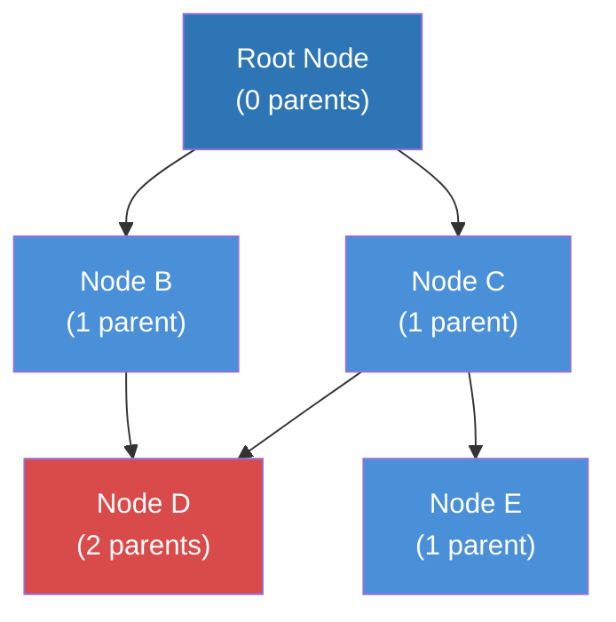
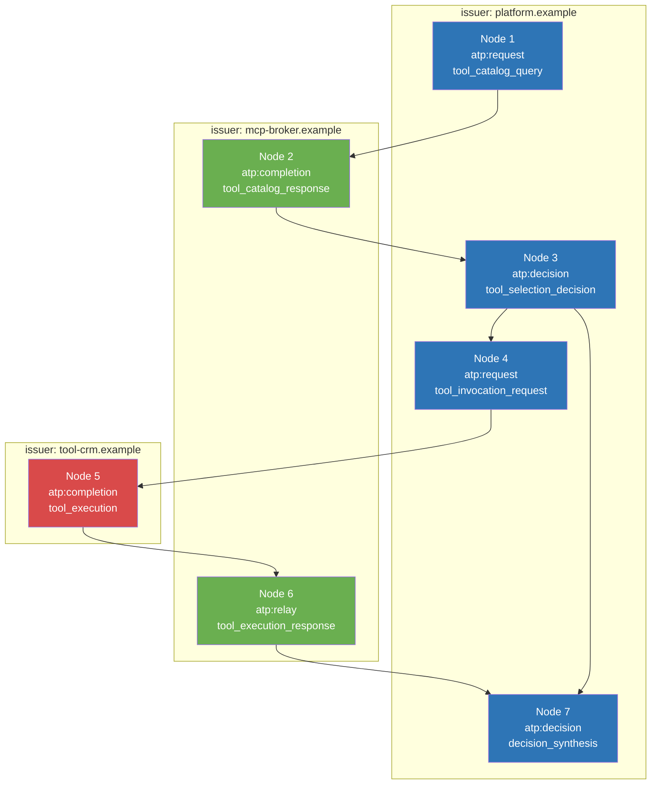
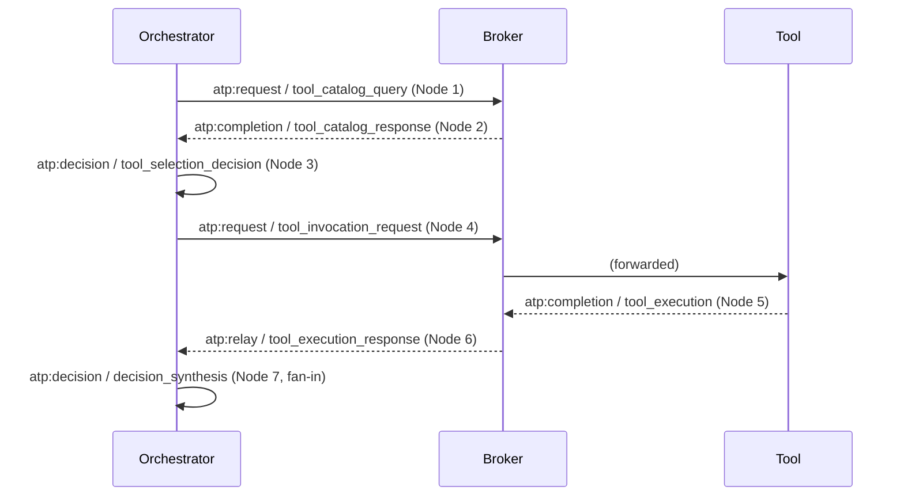

# Agent Transaction Protocol (ATP)

## Internet-Draft

draft-bates-atp-00

2026-05-10

---

# Status of This Memo

This Internet-Draft is submitted in full conformance with the provisions of BCP 78 and BCP 79.

Internet-Drafts are working documents of the Internet Engineering Task Force (IETF). Note that other groups may also distribute working documents as Internet-Drafts. The list of current Internet-Drafts is at https://datatracker.ietf.org/drafts/current/.

Internet-Drafts are draft documents valid for a maximum of six months and may be updated, replaced, or obsoleted by other documents at any time. It is inappropriate to use Internet-Drafts as reference material or to cite them other than as "work in progress."

This Internet-Draft will expire on 6 November 2026.

---

# Copyright Notice

Copyright (c) 2026 IETF Trust and the persons identified as the document authors. All rights reserved.

This document is subject to BCP 78 and the IETF Trust's Legal Provisions Relating to IETF Documents (https://trustee.ietf.org/license-info) in effect on the date of publication of this document. Please review these documents carefully, as they describe your rights and restrictions with respect to this document. Code Components extracted from this document must include Revised BSD License text as described in Section 4.e of the Trust Legal Provisions and are provided without warranty as described in the Revised BSD License.

---

# Abstract

ATP defines a cryptographically verifiable directed acyclic graph (DAG) model for agent transactions. ATP enables tamper-evident signed causality and auditable lineage across agentic systems by representing each action as a signed node with one or more parent references, assuming verifier access to issuer public keys and the referenced parent nodes. The protocol is designed to be lightweight, transport-independent, and suitable for environments where accountability, provenance, and verifiable history are required.

---

# 1. Introduction

Agentic systems are rapidly increasing in autonomy, composition, and reach. Agents now invoke tools, delegate work to other agents, operate across service boundaries, and act on behalf of both humans and non-human principals. Existing observability and identity standards solve parts of this problem, but they do not fully answer a more difficult governance question: can an independent verifier prove what action occurred, what prior actions caused it, and under whose authority it was taken?

ATP is intended to address that gap. ATP does not attempt to replace existing identity, authorization, transport, or observability mechanisms. Instead, ATP defines a minimal protocol for expressing agent actions as signed graph nodes with explicit parent references. This makes the resulting lineage tamper-evident; independent verification requires access to issuer public keys and parent nodes through deployment-specific mechanisms.

ATP is designed around causality rather than simple sequencing. Linear logs can describe what happened next, but complex agent systems require a model that can express branching, merging, delegation, and parallelism. ATP therefore adopts a DAG model so that the protocol can represent heritage truthfully rather than forcing artificial ordering.

## 1.1 Document Scope

This document defines **ATP Core**: the node schema, canonicalization, signing, validation, scope model, validation modes, security considerations, privacy considerations, operational guidance, IANA registries, and a Profile Framework that establishes how profiles MAY extend or constrain Core.

Profile-specific rules -- including domain-specific action-type vocabularies, emission and node-worthiness rules, sealed-scope semantics, composite conformance labels, the full profile specification template, and profile registration procedures -- are defined in separate profile specifications registered under the ATP Profiles registry (see Section 17.2 and Section 20). One illustrative example of such a profile is an ATP-MCP profile that defines composite conformance labels such as ATP-MCP-L1, ATP-MCP-L2, or ATP-MCP-L3 for chains describing Model Context Protocol [MCP] interactions; ATP-MCP is one possible profile among many and is not specially privileged by ATP Core. The companion document [ATP-PROFILES] is one such specification and is not normatively required to use ATP Core.

## 1.2 Cumulative Deferrals

ATP Core intentionally defers several operational concerns to deployments and future specifications: key discovery (Section 16.1), cross-scope retrieval and federation (Section 16.3), transport binding, deletion mechanisms (Section 16.9), well-known URI registration (Section 17.3), and algorithm agility (Section 10). Each individual deferral is a deliberate scope-discipline choice. Cumulatively, the minimum operationally complete deployment between two strangers therefore requires out-of-spec agreements on key publication, node availability, and transport. Deployments that cannot reach those agreements out-of-band SHOULD layer ATP with a transparency service or federation profile (Section 14.6, Section C.6) rather than expanding ATP Core.

# 2. Conventions and Requirements Language

The key words "MUST", "MUST NOT", "REQUIRED", "SHALL", "SHALL NOT", "SHOULD", "SHOULD NOT", "RECOMMENDED", "NOT RECOMMENDED", "MAY", and "OPTIONAL" in this document are to be interpreted as described in BCP 14 [RFC2119] [RFC8174] when, and only when, they appear in all capitals, as shown here.

For the purposes of this document:

- **Node:** A single ATP transaction object.
- **Parent:** A referenced prior node that contributes to the current node's heritage.
- **Heritage:** The recursively traversable causal lineage of a node.
- **Issuer:** The entity that signs the node.
- **Agent:** The execution identity that performed the action. An agent MAY be any executable identity -- a software service, an AI model, a robotic system, an automated process, or a human operator acting through an instrumented interface. ATP does not assume an agent is an AI model; the term is used in its general sense of "the entity that took the action."
- **Actor:** An OPTIONAL delegating principal on whose behalf the action was taken. The actor is distinct from the agent: the agent performs the action, the actor authorizes it. An actor MAY be a human, a service account, a scheduled-job identity, or another accountable non-human principal.
- **Scope:** The transaction boundary within which node identity and validation semantics are evaluated.
- **Validation:** The act of recomputing node identity, verifying signatures, and traversing parent relationships according to ATP rules.
- **Profile:** A normative specification that extends or constrains ATP Core for a specific deployment context, domain, or interoperability scope (see Section 20).
- **Profile Assessment:** A profile-defined evaluation of whether a node or scope satisfies a profile's emission, lineage, or completion rules. Profile assessment is distinct from ATP Core validation (see Section 20.7).

# 3. Problem Statement

Modern agentic systems create a governance gap. An action may be initiated by one principal, delegated to an orchestrator, enriched by multiple subordinate agents, and executed through tools or downstream systems. Traditional logs can record these events, but they are frequently mutable, centralized, or unable to prove lineage independently of the platform that produced them. Likewise, identity tokens can prove who was authenticated, but they do not provide a durable, linked record of what happened across a causal graph of actions.

This creates operational and governance problems, including but not limited to agent sprawl, weak accountability, incomplete audit trails, and difficulty reconstructing a trustworthy history of actions after an incident. ATP is intended to provide a common protocol layer for verifiable agent-action lineage without requiring a blockchain, without embedding large payloads, and without taking ownership of broader policy or trust-distribution concerns.

# 4. Design Goals

ATP is designed to satisfy the following goals:

- **Verifiable causality:** An implementation can determine what prior node or nodes caused a current action.
- **Tamper-evident heritage:** Changes to a node or its referenced lineage invalidate downstream verification.
- **Deterministic identity:** Independently implemented systems can compute the same node identity from the same canonical content.
- **Lightweight representation:** ATP carries hashes and lineage references rather than full payload bodies.
- **Transport independence:** ATP is not bound to a specific transport, runtime, vendor, or model provider.
- **Role separation:** Issuer, agent, and actor are represented distinctly so that governance questions can be answered without conflating execution identity and delegated authority.
- **DAG-native semantics:** ATP models branching and merging natively rather than forcing complex systems into an artificial linear chain.

# 5. Non-Goals

ATP intentionally does not define several adjacent concerns.

ATP Core does not define:

- trust registries or cross-organization trust anchors;
- key distribution, discovery, or long-term revocation infrastructure;
- payload storage or payload confidentiality controls;
- authorization policy or runtime access control decisions;
- consensus mechanisms or conflict resolution across divergent histories;
- execution semantics for how agents, tools, or workflows must behave;
- profile governance procedures, the profile specification template, or composite conformance labels (those are defined by individual profile specifications and by [ATP-PROFILES]);
- domain-specific node-worthiness, streaming semantics, or sealed-scope mechanisms (those are profile responsibilities, see Section 20);
- anti-suppression mechanisms (see Section 14.6); a transparency-service layer such as a SCITT-compatible service (see Section C.6) MAY be composed alongside ATP where anti-suppression is required.

Those concerns may be layered alongside ATP Core, but keeping them out of the core protocol is necessary to preserve implementability, interoperability, and scope discipline.

# 6. Architecture Overview

ATP is a protocol layer, not a full platform. ATP assumes that systems already have mechanisms for transport, execution, payload storage, and authorization. ATP adds a verifiable transaction layer that can travel alongside those mechanisms.

ATP is intentionally domain-neutral. It is suitable for AI agent orchestration, but equally suitable for any system that benefits from cryptographically signed, causally linked records of actions. Illustrative use cases include (non-exhaustively): an insurance underwriting workflow recording the chain of claim adjudication decisions; a fraud-detection pipeline recording each scoring step and the data used; a regulated medical-triage system recording why one path was selected over another; a supply-chain routing system recording handoffs between carriers; or any orchestrator-and-tool architecture (the pattern Appendix A illustrates). The protocol mechanics -- DAG-structured signed nodes with deterministic identity -- are the same in all cases.

At a high level, an ATP-aware system performs the following steps for each action:

1. Construct a transaction node describing the action.
2. Canonicalize the node according to ATP rules.
3. Compute the node identifier from the canonical content.
4. Sign the node identifier using the issuer's private key.
5. Store, emit, or transmit the signed node through implementation-specific means.
6. Validate the node and its parents when lineage or integrity must be verified.

ATP is intentionally compatible with centralized or decentralized storage patterns. A deployment MAY keep nodes in an append-only event store, a content-addressed object store, a relational database, or another storage substrate, provided ATP node integrity and parent resolution semantics are preserved.

## 6.1 Deployment Patterns

ATP does not mandate a single deployment topology. Three patterns are common; deployments MAY combine them.

**Pattern 1 -- Inline emission.** The executor that performs the action also constructs, signs, and persists the ATP node. The request node is constructed and signed *before* the action is invoked (its `inputHash` covers the request payload); the completion or failure node is constructed and signed *after* the action returns (its `outputHash` covers the result). This pattern requires the executor to hold issuer key material directly. It is the lowest-overhead pattern and is appropriate when the executor is the natural signing-authority boundary.

**Pattern 2 -- Sidecar emission.** The executor delegates ATP node construction and signing to a co-located ATP-emit service. The executor calls the sidecar with action metadata; the sidecar canonicalizes, signs, and persists. This pattern centralizes key custody at the sidecar boundary and is appropriate when the executor cannot or should not hold private key material directly.

**Pattern 3 -- Centralized audit service.** A separate service observes executor activity (via instrumentation, message-bus subscription, log shipping, or an explicit emit API) and constructs ATP nodes on the executor's behalf. In this pattern the *audit service* is the issuer, signing under its own key, and the executor is identified in the `agent` field. This pattern is appropriate when executors cannot be modified to participate in ATP directly.

Storage MAY be centralized (a shared node store accessible to all issuers) or decentralized (each issuer maintains its own store, with cross-issuer references resolved via Section 16.3 cross-scope mechanisms). ATP does not prescribe; the choice is operational. Implementations SHOULD document which pattern they implement so verifiers can correctly interpret the meaning of unresolved parent references in the chosen topology (Section 14.5, Section 14.6).

# 7. Data Model

ATP models agent actions as nodes in a directed acyclic graph.

A node MAY have zero parents, one parent, or multiple parents:

- A node with zero parents is a root node.
- A node with one parent expresses a simple causal dependency.
- A node with multiple parents expresses fan-in, merge, or synthesized heritage.

Multiple child nodes MAY reference the same parent. ATP therefore supports fan-out naturally.

The following diagram illustrates these structural patterns:



In this diagram:

- **Node A** is a root node with zero parents.
- **Nodes B and C** demonstrate fan-out: both reference Node A as a parent.
- **Node D** demonstrates fan-in: it references both Node B and Node C as parents, merging two causal lineages.
- **Node E** demonstrates a simple linear dependency on Node C.

ATP does not require total ordering across all nodes in a trust domain. The protocol is designed to preserve causal relationships rather than impose a global sequence. Implementations that require ordering MUST provide that behavior outside ATP or as a profile layered on top of ATP.

A valid ATP graph MUST be acyclic. No node may directly or indirectly reference itself through its parent relationships.

# 8. Node Schema

An ATP node is a structured object containing identity, causality, and signature material. The following fields are defined in the base model:

- **nodeId:** The deterministic identifier of the node.
- **timestamp:** The claimed creation time of the node.
- **scope:** The boundary within which the node's identity and lineage are evaluated.
- **issuer:** The signing authority for the node. `issuerId` identifies a signing-authority boundary (see Section 16.6).
- **agent:** The execution identity that performed the action. `agent.version` SHOULD change whenever the agent's decision-producing configuration changes (see Section 16.5).
- **actor:** An OPTIONAL delegating principal on whose behalf the action occurred (see Section 16.4).
- **action:** A description of the action and references to relevant payload hashes. Depending on node type, one or both of `inputHash` and `outputHash` MAY be present.
- **parents:** An ordered array of zero or more parent node identifiers. Each entry MUST be a `nodeId` value as defined in Section 10.1. The order of `parents` is significant for canonicalization (Section 9) but has no semantic priority unless a profile explicitly defines parent-position semantics. A `parents` array MUST NOT contain duplicate `nodeId` values unless a profile explicitly defines multiplicity semantics.
- **profile:** OPTIONAL. Identifies the ATP profile (see Section 20) whose additional rules apply to this node. When absent, ATP Core rules apply exclusively.
- **signature:** The cryptographic signature over the node identifier.

The base schema is as follows:

```jsonc
{
  "nodeId": "hex(SHA256(canonical_node))",
  "timestamp": "RFC3339",
  "scope": "string",
  "issuer": {
    "issuerId": "string",
    "keyId": "string"
  },
  "agent": {
    "agentId": "string",
    "version": "string"
  },
  "actor": {                  // OPTIONAL -- see below
    "actorId": "string",
    "authContext": "string"
  },
  "action": {
    "type": "string",
    "inputHash": "hex",
    "outputHash": "hex"       // OPTIONAL -- see below
  },
  "parents": ["nodeId"],
  "profile": "string",        // OPTIONAL -- see Section 20.1
  "signature": "base64"
}
```

The example above is illustrative; fields annotated as OPTIONAL MAY be omitted as defined in the surrounding prose. Per Section 9, omitted fields do not appear in the canonical form and do not affect nodeId computation.

The `actor` object is OPTIONAL. Actor identifies the delegating principal whose authority the agent is acting under. That principal MAY be a human, a service account, a scheduled-job identity, or another accountable non-human principal. When no delegating principal exists, `actor` is omitted. Such omission is meaningful: it indicates the action was not taken on behalf of an accountable principal.

When `actor` is omitted, validators MUST NOT treat the omission as missing data; the omission is itself a normative claim that no delegating principal exists. Implementations that fail to record an actor when one exists are emitter-side governance failures, not protocol ambiguities. Validators have no protocol-level mechanism to distinguish accidental omission from autonomous-action omission; deployments requiring that distinction MUST address it operationally -- for example, through emitter-side governance, profile-defined actor-required rules (per Section 20.3 node-worthiness), or out-of-band audit policy. Profiles MAY further constrain when `actor` MUST be present.

Within the `action` object, `outputHash` is OPTIONAL in the base protocol. A node MAY omit `outputHash` when the action's outcome is not yet known at emission time (see Section 16.2 for the request/completion pairing pattern).

The `profile` field is OPTIONAL. When present, validators MUST apply the validation rules of the identified profile in addition to ATP Core rules (see Section 20.1 and Section 20.4).

All other top-level fields shown above are REQUIRED unless a future profile or extension explicitly states otherwise.

Profiles MAY define additional top-level fields and additional fields within the `action` object as specified in Section 20.3 and Section 20.4. For example, profiles MAY add fields such as `action.subtype`; Appendix A illustrates this pattern.

A **decisional node** is a node that records a selection, policy decision, or synthesis without a direct invocation of an external system. Decisional nodes typically use `inputHash` to reference the material the decision was based on and `outputHash` to reference the decision rationale or output. The `atp:decision` action type (Section 17.1) is the canonical core action type for decisional nodes; Appendix A illustrates decisional-node usage in a multi-issuer chain.

A **relay node** is a node whose action semantics assert that input was forwarded without modification. Relay nodes have unique trust semantics that differ from request/completion semantics; full treatment is in Section 14.1, with relay-fidelity validation states defined in Section 14.2.

# 9. Canonicalization

Canonicalization is REQUIRED for ATP interoperability. Two conforming implementations presented with the same ATP node content MUST produce the same canonical byte sequence before hashing.

ATP implementations MUST canonicalize nodes according to RFC 8785 JSON Canonicalization Scheme (JCS) [RFC8785].

Before hashing:

- object keys MUST be sorted according to RFC 8785;
- UTF-8 encoding MUST be used;
- insignificant whitespace MUST NOT be included;
- arrays MUST preserve their declared order;
- null-valued fields MUST be omitted unless a future ATP profile explicitly defines otherwise.

Because canonicalization is foundational to deterministic identity, implementations that do not use RFC 8785 JCS are not conformant with this draft.

# 10. Signing and Verification

## 10.1 Node Identity

The node identifier is computed as:

```
nodeId = SHA256(canonical(node_without_signature))
```

The `signature` field itself MUST NOT be included in canonicalization or nodeId computation. The `nodeId` field, when present in a node representation, MUST also NOT be included in its own canonicalization. The `nodeId` is the *output* of canonicalization plus hashing; its inclusion in the input would be circular. Implementations computing or recomputing `nodeId` over a stored or transmitted node MUST first remove both `nodeId` and `signature` before canonicalization. Parent references, scope, timestamp, issuer, agent, actor (when present), `profile` (when present), and action fields MUST be included. Profile-defined fields, when present, MUST be included as specified in Section 20.4.

ATP Core mandates SHA-256 for `nodeId` computation. ATP Core does not define a hash-algorithm-agility mechanism. This is intentional and keeps the protocol simple at the cost of forward flexibility; if cryptographic developments require a different hash algorithm, that capability will be introduced in a future ATP Core revision or profile rather than negotiated within this version.

## 10.2 Signature Algorithm

Implementations conforming to this draft MUST support Ed25519 [RFC8032].

Additional algorithms MAY be supported by future ATP profiles, but interoperable baseline implementations MUST support Ed25519. ATP Core does not define a signature-algorithm-agility mechanism; the same forward-compatibility rationale stated for hash algorithms (Section 10.1) applies.

## 10.3 Signature Computation

The signature is computed over the nodeId:

```
signature = Sign(privateKey, nodeId)
```

The key used to generate the signature MUST correspond to `issuer.keyId`.

## 10.4 Verification

A node is **fully lineage-valid** under ATP only if all of the following conditions hold:

1. The node can be canonicalized successfully.
2. The nodeId recomputes exactly from the canonicalized node content excluding `signature`.
3. The signature validates against the issuer key identified by `issuer.keyId`.
4. All referenced parent nodes can be resolved in the relevant verification context.
5. All referenced parent nodes are themselves fully lineage-valid according to ATP rules.
6. No cycle is introduced by the node's parent relationships.

Conditions 1, 2, 3, and 6 together establish **node-level integrity** and apply to every validation mode. Conditions 4 and 5 establish **lineage validity** and apply only to validation modes that resolve parent nodes (full recursive validation per Section 13.1, and bounded validation within its declared boundary per Section 13.2). Tip validation (Section 13.3) intentionally does not resolve parents and therefore does not establish lineage validity.

Validation modes other than full recursive validation MAY produce mode-specific validation results as defined in Section 13. An implementation MUST NOT represent the result of tip validation, bounded validation, or redacted-lineage validation as full lineage validation.

A node with unresolved, invalid, or withheld parents MUST NOT be treated as fully lineage-valid in any verification context.

Conflict resolution between multiple valid child nodes that reference the same parent is out of scope for ATP.

If a validator cannot retrieve the public key for the (`issuerId`, `keyId`) pair identified in a node, the node MUST be reported as `keyUnresolved` in the validation result. A key-unresolved node MUST NOT be treated as cryptographically valid, and MUST NOT be classified as invalid. The `keyUnresolved` state is distinct from: an invalid node, whose key is available but whose signature verification fails; and an unresolved parent, whose content cannot be obtained in the current verification context.

A `keyUnresolved` node has not established node-level integrity, even when canonicalization succeeds and `nodeId` recomputes correctly. Node-level integrity (conditions 1, 2, 3, and 6 above) requires successful signature verification, which is impossible without the issuer key. Implementations MUST NOT report a key-unresolved node in the `verified` set of any validation mode.

When a parent node is `keyUnresolved`, the parent's signature cannot be verified. A child node referencing such a parent retains its own node-level integrity (assuming conditions 1, 2, 3, and 6 hold for the child's own content), but its **lineage validity is not established** for as long as the parent remains key-unresolved. Validators MUST report the parent under `keyUnresolved` and MUST NOT report the child as fully lineage-valid in that validation run. A subsequent re-validation that obtains the parent's public key MAY restore lineage validity for the child without re-signing the child, since the child's signature covers its own `nodeId` only.

# 11. Heritage and DAG Semantics

Heritage is the complete set of ancestor nodes reachable by recursively following parent references from a given node. Heritage establishes the causal lineage of an action.

ATP heritage has the following properties:

- **Transitivity.** If node C references node B as a parent, and node B references node A as a parent, then node A is part of node C's heritage.
- **Tamper evidence.** Because each nodeId is computed from canonical content that includes parent references, modifying any ancestor invalidates the nodeId of every descendant that references it, directly or transitively.
- **Non-exclusivity.** A node's heritage may include nodes signed by multiple issuers, spanning multiple scopes, and representing actions taken by multiple agents. Heritage is a graph property, not an ownership property.

Heritage traversal is the mechanism by which validators answer causal questions: "what caused this action?" is answered by walking parent edges; "was this action derived from a specific prior action?" is answered by checking whether a given nodeId appears in the heritage of the node under inspection.

ATP does not define a required traversal algorithm. Implementations MAY use depth-first, breadth-first, or other graph-traversal strategies. The protocol requires only that heritage traversal follows parent references and that each traversed node is subject to the applicable validation mode (see Section 13).

Because ATP graphs are DAGs, heritage traversal is guaranteed to terminate. The acyclicity constraint (Section 7) ensures that no traversal path can loop.

Fan-in nodes -- nodes with multiple parents -- create heritage that merges two or more causal lineages. This is intentional and necessary for representing actions that depend on multiple prior results, such as a synthesis that combines a tool execution result and a prior selection decision. Heritage traversal through a fan-in node follows all parent edges.

## 11.1 Identical Content and Idempotency

Because `nodeId` is content-addressed (Section 10.1), two emissions that produce identical canonical content will produce identical `nodeId` values. ATP treats such emissions as the same logical node: a verifier that encounters the same `nodeId` twice MAY deduplicate, and storage substrates MAY reject the second write as an idempotent no-op.

Where two distinct emissions are intended to be distinct nodes (for example, two retries of the same operation), emitters MUST ensure that some canonical field differs. Practical mechanisms include:

- a high-precision `timestamp` (sub-millisecond) so concurrent emissions are distinguishable;
- a profile-defined nonce field that participates in canonicalization per Section 20.4;
- a sequence number embedded in `agent.version` or another canonical field;
- distinct `inputHash` values when the underlying request payloads differ.

Emitters that allow identical canonical content for genuinely-distinct actions accept the consequence that those actions collapse into a single ATP node. This is sometimes desirable (the same logical event observed twice) and sometimes a correctness bug (two retries that should be separately auditable). Profiles MAY mandate a freshness mechanism for emission contexts where collapse is unacceptable.

# 12. Scope Model

Scope is REQUIRED on every ATP node.

Scope identifies the transaction boundary to which the node belongs. In typical deployments, a scope corresponds to one workflow execution, one request lifecycle, or one business transaction. ATP does not impose a global meaning beyond that boundary concept. Scope values SHOULD be unique per transaction and SHOULD be shared by all nodes that belong to the same transaction; that is, scope is a transaction-level identifier, not a node-level identifier.

Scope is an opaque string. ATP does not define or constrain its format. Implementations MAY use UUIDs, URNs, structured identifiers, or other stable values. Nodes that belong to the same transaction boundary SHOULD share the same scope value.

Each `parents` entry is a nodeId. Because nodeId is content-addressed and scope is a field inside the referenced node rather than part of the parent reference itself, parent references are scope-agnostic by definition.

Parent references MAY target nodes in the same scope or in different scopes. Cross-scope parent references are therefore PERMITTED.

When a validator resolves a parent node and discovers that the parent's scope differs from the current node's scope, that difference is not an error condition. The validator MUST proceed with normal ATP verification. If a parent nodeId can be resolved to content but the parent's declared scope differs from the current node's scope (including when the parent was obtained through out-of-band retrieval), the validator MUST still apply full ATP validation to the parent content; scope mismatch alone is not a validation failure.

A validator operating within a given verification context MUST attempt to resolve referenced parent nodes regardless of whether they are in the same scope or a different scope.

If a referenced parent node is obtained and fails ATP verification, that parent is **invalid**.

If a referenced parent node cannot be obtained in the current verification context -- including because the validator lacks access to the relevant scope, the referenced scope is unavailable, or verification is restricted to a single scope -- that parent is **unresolved**. The parent is not absent; it is simply not reachable in the current verification context.

Validators MUST distinguish between invalid parents and unresolved parents.

Full lineage verification requires access to all referenced parent nodes across all relevant scopes. Implementations MAY provide bounded or partial validation modes (see Section 13), but such modes MUST NOT treat unresolved parents as valid.

Scope participates in nodeId computation in the same way as other canonical node fields. Two nodes that are identical except for different scope values therefore produce different nodeId values. This is intentional: the same action in two different transaction contexts is represented as two different ATP nodes.

Because parent references are made to nodeId values rather than to scope membership, cross-scope heritage does not weaken ATP integrity semantics. It does, however, affect what a validator can practically resolve and verify in a given environment.

# 13. Validation Modes

Validation modes are verifier-side behaviors. ATP nodes are written the same way regardless of which validation mode a future verifier uses. Validation modes therefore affect how heritage is read and checked, not how nodes are emitted.

ATP defines four validation modes.

## 13.1 Full Recursive Validation

In full recursive validation, the validator resolves every parent recursively back to every reachable root node within the available verification context. Each traversed node MUST be canonicalized, its nodeId MUST be recomputed, its signature MUST be verified, and the traversed heritage MUST satisfy ATP DAG constraints, including acyclicity.

This mode provides the strongest lineage claim and is appropriate for incident forensics, regulatory audit, and dispute resolution. Full recursive validation is the only mode that establishes full lineage validity per Section 10.4.

## 13.2 Bounded Validation

In bounded validation, the validator declares a verification boundary, such as a depth horizon (e.g., "verify this node and 3 generations of parents") or a time horizon (e.g., "verify back to nodes created after timestamp T"). Every node within that declared boundary MUST be fully validated according to ATP rules. Parent nodes beyond the declared boundary are not re-verified in that validation run and MUST be reported as out-of-horizon.

This mode is appropriate for operational health checks, real-time monitoring, and performance-constrained environments. Bounded validation establishes lineage validity only within its declared horizon.

## 13.3 Tip Validation

In tip validation, the validator verifies only the node under inspection. The node MUST be canonicalized, its nodeId MUST be recomputed, and its signature MUST be verified. Declared parent references MUST be checked for structural presence, but parent nodes are not resolved or verified.

This mode is appropriate for ingestion-time integrity checks and other scenarios where the primary question is whether the node itself arrived intact. Tip validation establishes node-level integrity per Section 10.4 but does not establish lineage validity.

## 13.4 Redacted-Lineage Validation

In redacted-lineage validation, the validator is given a partial lineage in which one or more nodes are intentionally withheld for confidentiality, access-control, or privacy reasons. A withheld node MAY be represented by nodeId alone. In this mode, the validator can confirm that downstream nodes reference specific parent nodeIds, but cannot validate the withheld node's content or signature unless the withheld node is later made available.

Withheld nodes are distinct from unresolved nodes. A withheld node is intentionally omitted but acknowledged. An unresolved node is one that the validator could not obtain in the current verification context.

The distinction between withheld and unresolved is communicated to the validator out-of-band: it is the responsibility of the party providing the chain (the chain-bundle producer, the API endpoint, the audit-export tool, or equivalent) to declare which nodeIds are withheld. ATP Core does not define a normative protocol for this declaration; in practice, deployments use an explicit `withheldNodeIds` list in the chain-exchange envelope (Section 16.12), an out-of-band agreement between the auditor and the audited party, or a profile-defined sentinel in node payloads. Validators MUST NOT infer withheld status from absence alone -- absence is unresolved unless explicitly declared withheld.

This mode is appropriate for cross-organization audits and permissioned verification contexts where not all parties have access to all nodes.

## 13.5 Minimum Support and Validation Results

Implementations MUST support tip validation at minimum.

Implementations that claim support for full lineage verification (i.e., the full recursive validation mode defined in Section 13.1) MUST implement that mode and MUST report results in the format defined in Section 13.6.

Bounded validation and redacted-lineage validation are OPTIONAL. When implemented, they MUST clearly report validation depth, out-of-horizon nodes, unresolved nodes, and withheld nodes as applicable.

A validation result MUST include, at minimum:

- the validation mode used;
- the set of verified nodes;
- the set of invalid nodes, if any;
- the set of unresolved nodes, if any;
- the set of withheld nodes, if any;
- the set of out-of-horizon nodes, if any;
- the set of key-unresolved nodes, if any; and
- the set of profile-unresolved nodes, if any.

No validation mode may silently suppress unresolved, withheld, invalid, out-of-horizon, key-unresolved, or profile-unresolved lineage gaps.

## 13.6 Validation Result Format

Validation results MUST be expressed as a JSON object with the following top-level keys:

```json
{
  "mode": "full",
  "boundary": {},
  "verified": [],
  "invalid": [],
  "unresolved": [],
  "withheld": [],
  "outOfHorizon": [],
  "keyUnresolved": [],
  "profileUnresolved": [],
  "relayFidelity": {}
}
```

The fields are defined as follows:

- **`mode`** (string): The validation mode used for this result. MUST be one of `"full"`, `"bounded"`, `"tip"`, or `"redacted"`, corresponding to the validation modes defined in Sections 13.1 through 13.4.
- **`boundary`** (object, OPTIONAL): When `mode` is `"bounded"`, the declared verification boundary that was applied (Section 13.2). REQUIRED when `mode` is `"bounded"` and SHOULD be omitted otherwise. The object MUST contain at least one of: `"depth"` (integer -- the parent-generation depth checked) or `"sinceTimestamp"` (RFC 3339 string -- the time horizon checked). Implementations MAY include additional implementation-specific boundary descriptors. The `boundary` object makes bounded-validation results self-describing so that operators and downstream auditors know exactly what was verified.
- **`verified`** (array of strings): The nodeId hex strings of all nodes that passed the validation checks applicable to the selected validation mode (Sections 13.1 through 13.4). Tip validation establishes node-level integrity only; full recursive validation establishes full lineage validity (see Section 10.4). Implementations MUST NOT represent `verified` entries from non-full modes as full lineage validation.
- **`invalid`** (array of strings): The nodeId hex strings of nodes that failed ATP validation. Causes include, but are not limited to, canonicalization failure, nodeId mismatch, signature failure, acyclicity violation, and strict-mode profile-resolution failure as defined in Section 20.4. Profiles MAY define additional invalidity causes; such causes MUST be enumerated in the profile specification.
- **`unresolved`** (array of strings): The nodeId hex strings of parent nodes that could not be obtained in the current verification context.
- **`withheld`** (array of strings): The nodeId hex strings of nodes that were intentionally omitted but acknowledged in a redacted-lineage context (Section 13.4).
- **`outOfHorizon`** (array of strings): The nodeId hex strings of nodes lying outside the declared validation boundary in bounded validation (Section 13.2).
- **`keyUnresolved`** (array of strings): The nodeId hex strings of nodes whose issuer public key could not be retrieved for the (`issuerId`, `keyId`) pair, preventing signature verification (Section 10.4).
- **`profileUnresolved`** (array of strings): The nodeId hex strings of nodes whose `profile` value was not recognized by the validator (per Section 20.4). In permissive mode, a profile-unresolved node MAY still pass ATP Core validation and appear in `verified`; in strict mode it is also reported in `invalid`. Profile-unresolved nodes are always reported in this category so that operators can detect interoperability gaps.
- **`relayFidelity`** (object, OPTIONAL): An object keyed by nodeId hex string, with values indicating the relay fidelity state of relay nodes as defined in Section 14.2. Permitted values are `"Verified"`, `"Asserted"`, and `"Contradicted"`.

Absent categories MUST be represented as empty arrays, not omitted. The `relayFidelity` object MAY be omitted when no relay nodes are present in the validated set. The `boundary` object MUST be present when `mode` is `"bounded"` and SHOULD be omitted in other modes. Profiles MAY extend this structure with additional keys.

## 13.7 ATP Core Conformance

An implementation is **ATP Core conformant** if it satisfies all of the following requirements:

- canonicalizes nodes according to RFC 8785 JCS as required by Section 9;
- computes `nodeId` per Section 10.1, including all required fields and any `profile` field when present;
- generates and verifies Ed25519 signatures per Section 10.2 and Section 10.3;
- enforces acyclicity per Section 7;
- implements at least tip validation (Section 13.3);
- produces validation results in the format defined by Section 13.6, including all required result categories;
- distinguishes invalid, unresolved, withheld, out-of-horizon, key-unresolved, and profile-unresolved nodes per Section 13.5;
- treats the `atp:` action-type prefix as reserved per Section 17.1;
- passes all golden test vectors published in [ATP-TEST-VECTORS] for canonicalization, `nodeId` computation, and Ed25519 signature verification.

ATP Core conformance is the floor required for any ATP implementation.

**Profile conformance is always additive.** An implementation that is ATP Core conformant MAY additionally claim conformance with one or more profiles registered per Section 17.2. Profile conformance requires both ATP Core conformance and satisfaction of all rules declared by the relevant profile. A profile MUST NOT weaken any ATP Core conformance requirement (Section 7, Section 10).

Composite conformance labels (such as ATP-MCP-L1, ATP-MCP-L2, and ATP-MCP-L3) are not defined by ATP Core. Such labels are defined by individual profile specifications.

# 14. Security Considerations

ATP signatures prove that an issuer made a claim about a node. They do not, by themselves, prove that every claim carried in the node is true in the external world.

## 14.1 Relay Node Trust Semantics

A **relay node** is a node whose action semantics assert that input was forwarded without modification. Relay nodes deserve a dedicated treatment because they have a unique trust property: the relay issuer's signature proves that the issuer *made the non-modification claim*, but it does not prove the claim is true. Other ATP action types (`atp:request`, `atp:completion`, `atp:failure`, `atp:decision`) carry claims that are intrinsic to the issuer's own activity (the issuer asked, completed, failed, or decided). Relay nodes are the only ATP-Core action type whose claim is *about another party's data*, which is why their fidelity must be evaluated separately. ATP defines `atp:relay` (Section 17.1) as the canonical core action type for relay nodes. A common indicator within `atp:relay` nodes is `inputHash` equals `outputHash`. Profiles MAY define additional relay action types, provided their semantics are explicitly declared per Section 20.3.

Profiles that define relay-like action types MUST state how relay fidelity is evaluated for those types. Permitted evaluation methods include: payload hash equality (e.g., `inputHash` equals `outputHash`), direct-origin signature validation, dual-parent lineage (per the mitigations in this section), or profile-specific rules. Profile-defined relay types whose fidelity evaluation is not declared MUST be treated by validators as equivalent to `atp:relay`.

A node whose action semantics imply relay, forwarding, or pass-through behavior MUST be understood as an issuer assertion of fidelity. The signature binds the relay issuer to that claim, but does not independently prove payload integrity across the relay boundary.

Validators MUST NOT treat a relay node's signature as proof that the referenced payload was unmodified. The signature proves only that the relay issuer made a non-modification claim.

When a downstream node is itself signed by a separate issuer, validators SHOULD verify the downstream node's signature directly rather than relying solely on the relay node's fidelity claim.

When the originating node that a relay claims to forward is reachable via parent references or other available lineage context, validators SHOULD verify the originating node's signature directly. This is the strongest fidelity check available within ATP.

When the originating node is unreachable, including because it is cross-scope, access-restricted, unresolved, or withheld, validators SHOULD report relay fidelity as asserted rather than verified.

Implementations that require strong relay fidelity guarantees SHOULD adopt one or more of the following mitigations:

- **Direct parent resolution:** The consuming node references the originating node (skipping the relay) so that validators can verify the original signature directly.
- **Dual-parent pattern:** The consuming node references both the relay node and the originating node, preserving both the chain-of-custody path and a direct verification path.
- **Out-of-band payload verification:** The validator independently retrieves the payload identified by the relevant hash and recomputes integrity outside the ATP graph.

Relay nodes remain valid and useful ATP nodes. They record that a boundary was crossed, who claims to have crossed it, and what fidelity assertion was made. ATP treats relay nodes as accountability artifacts, not as automatic proof of non-modification.

If a relay issuer's fidelity assertion is later shown to be false, the signed relay node remains evidence that the issuer made that assertion.

## 14.2 Relay Fidelity Validation States

For relay-node fidelity, validation results SHOULD distinguish at least the following states:

- **Verified:** The originating node is resolved, signatures validate, and the relay claim is consistent with the originating material.
- **Asserted:** The relay node is validly signed but the originating node was not independently verified.
- **Contradicted:** The originating node is resolved and the relay claim does not match the originating material.

These states are specific to relay fidelity semantics and do not replace the broader ATP validation result categories defined in Section 13.5.

## 14.3 Timestamp Trust

The `timestamp` field is a claimed value set by the node emitter. ATP does not define a trusted time source or require synchronized clocks. Validators SHOULD treat timestamps as issuer assertions subject to the same trust considerations as other node content.

## 14.4 Signature Scope

An ATP signature covers the nodeId, which is derived from the canonical node content. The signature does not cover the referenced payloads themselves -- only their hashes. Payload integrity depends on the hash algorithm and the availability of the original payload for recomputation.

## 14.5 Trust Model Summary

ATP's security guarantees rest on three trust assumptions. These assumptions are stated individually elsewhere in this document and are collected here for the benefit of implementers and reviewers.

- **Issuer key availability.** Verifiers are assumed to be able to retrieve issuer public keys for any (`issuerId`, `keyId`) pair that appears in the chain. Key discovery is intentionally deferred to deployments and future specifications (Section 16.1). When a key is unavailable, the affected node is `keyUnresolved` rather than invalid (Section 10.4).
- **Node availability.** Full lineage verification requires that all referenced parent nodes be retrievable in the verifier's verification context. ATP does not define a federation or cross-scope retrieval protocol (Section 16.3). Where parent nodes are unavailable, the affected nodes are `unresolved` and lineage validity is not established (Section 10.4, Section 13.5).
- **Issuer honesty (within signature scope).** ATP signatures prove that an issuer made a claim about a node. They do not prove that the claim is true in the external world. Timestamps (Section 14.3), action types, and payload references are all issuer assertions subject to operational trust in the issuer.

These assumptions are deliberate scope choices, not omissions. ATP composes with identity, authorization, transparency, and federation mechanisms that strengthen each assumption (Section 14.6, Section C.6) without expanding ATP Core.

## 14.6 Suppression and Anti-Suppression

ATP detects modification but not suppression. A malicious operator who controls a node store MAY withhold individual nodes from a verifier. A verifier observing `unresolved` parents cannot, on the basis of ATP alone, distinguish between (a) nodes that exist elsewhere but are unreachable in the current verification context, (b) nodes that have been deliberately suppressed, and (c) nodes that were never written.

ATP Core does not provide an anti-suppression mechanism. This is a deliberate scope choice, not an oversight.

Deployments that require operator-independent assurance against suppression SHOULD layer ATP with an append-only transparency service such as a SCITT-compatible service [SCITT]. In such a composition:

- ATP nodes (or their `nodeId` values) are published to the transparency service as signed statements;
- the transparency service provides operator-independent evidence that the node existed at a given time and was not retroactively suppressed;
- ATP retains its causal-DAG and lineage-validity semantics over the underlying chain.

Profiles MAY define normative SCITT-compatible or equivalent publication patterns. ATP Core does not require such layering, but the protocol is designed to compose with it (see Section C.6 for further discussion of the SCITT relationship).

## 14.7 Replay and Scope Binding

Because `scope` participates in canonicalization (Section 9, Section 12), a node's `nodeId` is bound to its declared scope. A literal replay of a signed node into a different scope produces a different recomputed `nodeId`; the original signature does not validate against that different `nodeId`. Replay across scopes is therefore not, by itself, a node-integrity attack.

However, a malicious party who obtains a signed node MAY present that node in a different verification context where its declared scope value happens to be permitted or expected. Validators MUST evaluate scope semantics within their verification context and MUST NOT accept a node as evidence of an action in a verification context whose scope semantics do not match the scope value declared by the node.

ATP Core does not define an anti-replay mechanism beyond scope binding. Deployments requiring stronger anti-replay protection (for example, freshness guarantees against same-scope replays after a long interval) SHOULD layer additional context-binding outside the protocol -- for example, transport-layer freshness tokens, audited delivery channels, or profile-defined nonce fields participating in canonicalization per Section 20.4.

# 15. Privacy Considerations

ATP nodes carry metadata about actions, identities, and causal relationships. Even when payload content is stored externally and referenced only by hash, the existence of a node in an ATP chain reveals that an action was taken, by which agent, on behalf of which actor (when present), and in what causal relationship to other actions.

## 15.1 Data Minimization

ATP's design supports data minimization by carrying hashes rather than full payloads. However, the metadata fields themselves -- including `actorId`, `agentId`, `issuerId`, and `action.type` -- may constitute personal data or sensitive operational data depending on the deployment context and applicable jurisdiction.

Implementations SHOULD evaluate whether node metadata requires protection under applicable privacy regulations and SHOULD apply access controls to ATP node storage and retrieval accordingly.

## 15.2 Deletion and Retention Tension

ATP's tamper-evident properties create a tension with data subject rights such as the right to erasure under GDPR and similar regulations.

Payloads referenced by `inputHash` and `outputHash` are stored outside the ATP chain and MAY be deleted independently without invalidating the chain's structural integrity. The hash references will remain, but the referenced content will no longer be retrievable.

Node metadata within the chain -- including `actorId`, `agentId`, timestamps, and causal relationships -- cannot be removed without invalidating the node's signature and the nodeId references of all descendant nodes.

Implementations that must accommodate deletion rights SHOULD consider the following approaches:

- Store personal data exclusively in external payloads referenced by hash, not in node metadata fields.
- Use pseudonymous or indirect identifiers in `actorId` that can be dereferenced through a separate, deletable mapping.
- Apply redacted-lineage validation (Section 13.4) so that nodes containing personal data can be withheld from verification contexts when required.

ATP does not define a normative deletion or redaction mechanism. The tension between immutable audit evidence and deletion rights is an operational and legal concern that deployments must address in the context of their applicable regulatory requirements.

## 15.3 Chain Existence as Metadata

Even when all payload content and personal identifiers are removed or pseudonymized, the existence of an ATP chain itself -- including its structure, depth, timing, and issuer distribution -- may reveal operationally sensitive information. Implementations SHOULD apply appropriate access controls to chain metadata, not only to payload content.

## 15.4 Pseudonymous Identifiers and Post-Deletion Verification

Implementations SHOULD use pseudonymous or indirect identifiers in `actorId` rather than directly identifying personal data. A separate identity-resolution service SHOULD manage the mapping between pseudonymous identifiers and real identities.

When a data subject exercises a right to erasure, the RECOMMENDED approach is to delete the identity-resolution mapping and any external payloads containing personal data. The ATP chain itself is not modified.

After identity-resolution deletion, the `actorId` value remains in the chain but can no longer be resolved to a natural person. The chain's structural integrity, signatures, and causal relationships are unaffected.

Implementations MUST NOT rely on `actorId` opacity alone as a privacy control. If the `actorId` value itself is directly identifying -- for example an email address or employee number -- deletion of the mapping service does not remove the personal data from the chain. Pseudonymous identifiers are therefore RECOMMENDED as the default.

Following deletion of identity mappings or external payloads, validators SHOULD use redacted-lineage validation as described in Section 13.4 when verifying historical chains that include now-unresolvable or now-withheld elements.

Deployments subject to data protection regulations SHOULD document their ATP data retention and deletion procedures as part of their privacy impact assessment.

# 16. Operational Considerations

## 16.1 Key Lifecycle

ATP does not define a key management protocol, key discovery mechanism, or trust registry. However, ATP deployments depend on durable issuer key practices in order for signed nodes to remain verifiable over time.

Each issuer controls its own key material. No issuer is expected to hold another issuer's private key. Private key storage is implementation-specific and MAY use HSMs, cloud KMS systems, local keystores, or other suitable mechanisms. The operational requirement is that the private key associated with a given `issuer.keyId` can generate ATP-conformant Ed25519 signatures, and that validators can obtain the corresponding public key for verification.

An issuer MAY rotate signing keys at any time by beginning to sign new nodes with a new keyId.

Previously signed nodes remain valid after rotation. A node continues to identify the key that was active when it was signed through its `issuer.keyId` value.

An issuer MUST maintain the ability to provide the public key for any keyId that appears in its signed nodes for as long as those nodes may need to be verified.

ATP Core does not define a public key discovery mechanism or a normative well-known URI path for key publication. Implementations MAY use well-known URIs, JWK sets, append-only key logs, out-of-band registries, or other equivalent mechanisms that allow a validator to retrieve the public key for a given (`issuerId`, `keyId`) pair. A future ATP specification or profile MAY define a normative key-discovery path; this document does not.

This deferral creates a practical interoperability consequence: until a normative key-discovery path exists, two implementations that wish to cross-verify each other's chains MUST agree on a key-retrieval mechanism out-of-band. Cross-organization verification is therefore fragmented at the discovery layer even though node integrity, identity computation, and signature verification are deterministic. Profiles requiring open cross-organization verifiability SHOULD define a key-publication mechanism (for example, a JWK set served at a profile-specified well-known URI) and SHOULD declare it as a profile conformance requirement.

Key retirement does not invalidate previously signed nodes. The nodeId and signature remain correct; only the deployment's ability to verify those nodes depends on continued public key availability.

Implementations SHOULD plan for indefinite retention of public keys for any keyId that has been used in production signing.

Deployments are RECOMMENDED to publish or otherwise maintain an append-only public key record per issuer so that historical keyIds remain resolvable even after active signing use has ended.

## 16.2 Request/Completion Pairing

ATP does not require a single emission timing model for all action types. However, when implementations require auditable evidence of attempted, in-progress, completed, or failed actions, a paired request/completion pattern is RECOMMENDED.

In this pattern, a **request node** (typically `atp:request`, see Section 17.1) records intent. The request node carries `inputHash` covering the request payload. `outputHash` is omitted (not zeroed or set to a placeholder -- absent). Per Section 9, null-valued fields are omitted during canonicalization, so this is consistent with deterministic identity computation.

A **completion node** (typically `atp:completion`, see Section 17.1) records outcome. The completion node references the request node as a parent. The completion node SHOULD carry an `inputHash` matching the request node's `inputHash` so that validators can determine that both nodes describe the same logical action. The completion node carries `outputHash` covering the response or result payload.

A **failure** is also represented as a completion node, typically using `atp:failure` (Section 17.1). The relevant `action.type` SHOULD indicate failure semantics, and `outputHash` SHOULD cover any resulting error payload.

ATP does not mandate that profiles use the core `atp:request`, `atp:completion`, and `atp:failure` types directly. Profiles MAY define more specific action types that follow the same emission semantics, provided the profile specification declares the mapping (per Section 20.3).

If an emitter crashes or otherwise fails between request-node emission and completion-node emission, the unpaired request node remains a valid ATP node. Validators and operational tooling SHOULD report unpaired request nodes as open or incomplete rather than invalid. This behavior is intentional and provides crash-recovery and interrupted-action visibility.

## 16.3 Cross-Scope Resolution

Cross-scope parent verification is an operational capability, not a separate ATP protocol. Implementations that expect validators to verify nodes across scope boundaries SHOULD ensure that validators can retrieve referenced nodes across those boundaries.

This MAY be achieved through a shared node store, an API-based retrieval mechanism, or another exchange mechanism. ATP does not define a federation protocol or a required topology for cross-scope node access.

## 16.4 Actor Mapping Guidance

In governed deployments, actor omission SHOULD be uncommon. Most ATP nodes ought to identify the principal whose authority the agent is acting under.

`actor` represents the delegating principal. That principal MAY be human or non-human.

When a human initiates an action, `actorId` SHOULD identify the human principal and `authContext` SHOULD identify the authentication mechanism, such as SAML or OIDC.

When a machine-originated chain has no human initiator, `actorId` SHOULD identify the accountable service principal -- the service account, scheduled-job identity, CI/CD pipeline identity, managed identity, or equivalent non-human principal. `authContext` SHOULD identify the credential or trust mechanism used, such as workload identity, managed identity, service account, or API key.

When there is genuinely no delegating principal and the agent is acting autonomously, `actor` MAY be omitted. Such omission is a meaningful signal: it indicates the action was not taken on behalf of an accountable principal. Implementations SHOULD treat frequent actor omission as a governance concern rather than as routine behavior. See Section 8 for the corresponding verifier rule on omission.

## 16.5 Agent Versioning Guidance

ATP does not mandate a versioning scheme for `agent.version`. Implementations MAY use semantic versions, date-based versions, commit hashes, or other distinguishable version identifiers.

However, `agent.version` SHOULD change whenever the agent's decision-producing configuration changes. The governing test is **configurational**, not run-time behavioral: if the *configuration* that produces outputs changes such that the agent could produce a different output for the same input, the version SHOULD change. Run-time output variance that is intrinsic to the agent's design -- for example, a sampling LLM with no fixed seed producing different completions for identical prompts -- does NOT require a version bump on every emission. The version tracks the agent the way a software version tracks a binary: it changes when the binary changes, not when the binary processes different inputs.

Changes that SHOULD trigger a new `agent.version` include, but are not limited to:

- a software code change that alters decision logic (a refactor, a routing-rule change, a control-flow modification);
- a model swap (for AI agents);
- a prompt, template, or few-shot example change (for AI agents);
- a tool-scope change that affects what tools the agent can select or invoke;
- a policy-bundle, guardrail, or business-rule change that affects output behavior; and
- a configuration change that affects output behavior, such as sampling parameters, retrieval settings, scoring weights, or generation parameters.

Changes that ordinarily SHOULD NOT trigger a new `agent.version` include infrastructure-only changes that do not affect decision behavior, such as scaling changes, region failover, key rotation, logging changes, observability changes, or transport/protocol upgrades that do not alter the agent's decision logic. Run-time non-determinism (sampling, random-seed-based variation, time-of-day-dependent behavior) likewise does NOT trigger a version bump unless the *configuration* of that non-determinism changes.

ATP cannot enforce correct version bumps at the protocol level. If an implementation changes agent behavior without changing `agent.version`, that is an implementation governance failure rather than a protocol ambiguity.

## 16.6 Issuer Identity Granularity

ATP does not prescribe a required granularity for `issuerId`. `issuerId` identifies a signing-authority boundary: the entity that controls the private key material and is accountable for the nodes it signs. That boundary MAY align with a tenant, a deployment, a region, a service, or another organizational unit.

The governing principle is key custody. Nodes signed under the same `issuerId` share the same key-custody boundary. If two systems have independent key custody -- for example, different key storage, different rotation policies, or different operational teams -- they SHOULD use different `issuerId` values.

Conversely, systems that share key custody MAY share an `issuerId`.

Implementations SHOULD choose `issuerId` granularity such that compromise of one issuer's key material does not implicate nodes signed by a different issuer. This is the primary security constraint on `issuerId` design.

The combination of `issuerId` and `keyId` MUST be unique within the relevant verification context. Two different issuers MUST NOT share a `keyId` value that maps to different keys within that context.

ATP does not mandate whether `issuerId` maps to tenants, deployments, services, or regions. This is an operational design decision. An enterprise with centralized key custody MAY use one `issuerId` across multiple agents or services. A deployment with per-tenant or per-environment key isolation SHOULD use distinct `issuerId` values that reflect those custody boundaries.

## 16.7 Storage Model Guidance

ATP does not mandate a storage substrate. Implementations MAY use append-only logs, content-addressed object stores, relational databases, or other storage systems.

In practice, three storage patterns are common:

**Pattern A -- Append-only event log.** Nodes are written sequentially to a log. Parent resolution is performed by index lookup or by a secondary index on `nodeId`. This pattern integrates naturally with event-sourced architectures and operational monitoring systems, but parent resolution across large graphs depends on effective indexing.

**Pattern B -- Content-addressed object store.** Nodes are stored keyed by `nodeId`. Because `nodeId` is derived from canonical node content, this pattern aligns closely with ATP's deterministic identity model and supports direct parent lookup by `nodeId`. However, temporal ordering and operational queryability may require additional indexing.

**Pattern C -- Hybrid.** Nodes are written to an append-only log for temporal ordering and operational queries, and are also indexed or stored by `nodeId` for efficient parent resolution. This pattern supports both operational visibility and efficient heritage traversal at the cost of greater implementation complexity.

Regardless of storage choice, implementations MUST ensure that a node can be retrieved by `nodeId` with sufficient performance to support the validation modes the deployment intends to offer.

Implementations that support full recursive validation (Section 13.1) SHOULD ensure that parent resolution by `nodeId` remains efficient at scale, since recursive validation traverses the full heritage graph.

Implementations MUST ensure that stored nodes are immutable once written. Mutation of a stored node invalidates its `nodeId`, breaks downstream parent references, and defeats ATP's tamper-evidence guarantees for any verifier that does not retain the original bytes. Implementations MAY enforce immutability through storage-engine constraints -- for example, write-once tables, content-addressed object stores, append-only logs, or `BEFORE UPDATE` triggers that reject row modifications.

Storage-layer integrity checks, such as recomputing `nodeId` from stored content as an operational health measure, are RECOMMENDED. However, such checks are not a substitute for ATP validation.

## 16.8 Permissioned Verifiability

ATP does not define an access-control model for node retrieval. Access control over who may retrieve and verify which nodes is an implementation and deployment concern.

In practice, ATP deployments often serve multiple verification audiences with different access rights.

**Tier 1 -- Full-chain verification.** A verifier with unrestricted access to all relevant nodes and scopes can perform full recursive validation as defined in Section 13.1.

**Tier 2 -- Scoped verification.** A verifier with access limited to particular scopes, issuers, time ranges, or other node attributes validates the nodes available in that verification context. Parents outside that boundary are reported as unresolved or out-of-horizon according to the applicable validation mode.

**Tier 3 -- Redacted verification.** A verifier is given a partial chain in which sensitive nodes are withheld and represented only by `nodeId` or by withheld-node placeholders consistent with Section 13.4. The verifier can validate visible nodes, confirm visible chain structure, and transparently report withheld nodes.

Implementations that serve multiple verification audiences SHOULD provide mechanisms to scope node access by verification context -- for example, by scope, by issuer, by time range, or by other node attributes.

When a verification context restricts the nodes available to a verifier, the verifier MUST use the appropriate validation mode and MUST report any nodes that are unresolved, withheld, or out-of-horizon in the validation result.

Implementations MAY offer a **hash-only verification path** in which a verifier is given only `nodeId` values and parent references without full node content. This allows the verifier to confirm chain structure and determine whether one node descends from another without access to the metadata of intermediate nodes.

ATP does not define a protocol for permissioned export, redacted-chain generation, or verifier authorization. Those mechanisms remain implementation-specific.

## 16.9 Deletion and Redaction Operations

ATP does not define a deletion protocol, a redaction protocol, or an identity-resolution service. Those mechanisms remain implementation-specific.

In practice, deployments can reduce privacy tension through three operational layers:

**Layer 1 -- Keep personal data out of node metadata.** Deployments SHOULD prefer pseudonymous identifiers in `actorId` and SHOULD avoid embedding directly identifying personal data in `actorId`, `agentId`, `issuerId`, or `action.type`.

**Layer 2 -- Delete external payloads freely.** Payloads referenced by `inputHash` and `outputHash` may be deleted independently of the ATP chain without breaking ATP structural integrity.

**Layer 3 -- Verify post-deletion chains using the appropriate validation mode.** After identity-resolution deletion or payload deletion, validators SHOULD use redacted-lineage validation or another appropriate restricted verification mode so that withheld or now-unresolvable content is reported transparently rather than treated as invalid.

These operational practices do not eliminate the legal or governance tension between immutable evidence and deletion rights, but they make privacy-preserving ATP deployments practical without modifying the core protocol.

## 16.10 Performance Budget Guidance

ATP does not define benchmark requirements. Performance depends on implementation language, hardware, storage design, graph shape, and validation mode. However, deployments SHOULD understand four distinct ATP cost centers.

**Cost 1 -- Canonicalization.** Canonicalization cost scales primarily with node count rather than with node complexity because ATP nodes are structurally small and regular. For most deployments, canonicalization is not the dominant validation cost.

**Cost 2 -- Signing and signature verification.** Ed25519 signing and verification are computationally lightweight for individual nodes. In bulk validation scenarios, signature verification cost becomes measurable but remains parallelizable because each node's signature is independent.

**Cost 3 -- Parent resolution.** The dominant performance cost in ATP validation is usually parent resolution: retrieving referenced nodes by `nodeId`. Implementations SHOULD optimize node retrieval by `nodeId` as a primary access pattern.

**Cost 4 -- Lineage traversal.** Full recursive validation traverses the entire heritage graph and therefore scales linearly with the number of reachable nodes in that heritage. Bounded validation caps traversal according to the declared horizon. Tip validation avoids heritage traversal entirely.

Implementations that support full recursive validation (Section 13.1) SHOULD ensure that parent resolution by `nodeId` remains efficient at scale, since recursive validation traverses the full heritage graph.

Implementations that serve latency-sensitive validation requests SHOULD consider bounded validation (Section 13.2) or tip validation (Section 13.3) for operational use cases, reserving full recursive validation for audit and forensic contexts.

Implementations SHOULD monitor and report heritage depth and branching factor for production scopes. Unusually deep or wide graphs may indicate emitting-system design issues, excessive delegation, or insufficient scope partitioning.

Caching of previously validated subtrees is permitted and RECOMMENDED for deployments that perform repeated validation of overlapping heritage. Cached validation results MUST be invalidated if the validator's trust in any issuer key changes, for example because of key compromise, key replacement, or revocation-related policy change.

## 16.11 Node Granularity Guidance

ATP Core does not normatively prescribe what events MUST or MUST NOT produce ATP nodes -- that is profile responsibility (Section 20.3). However, deployments and profile authors benefit from a shared default. The governing principle is: **an ATP node represents an action that warrants independent audit**, not every internal computation step.

The following non-normative heuristics describe the typical default:

**Node-worthy events** (typically emitted as ATP nodes):

- External tool invocations and their completions (cross-process, cross-service, or cross-organization calls).
- Cross-agent dispatches (one agent handing work to another).
- Cross-issuer payload forwarding events (relay nodes).
- Decisions that materially affect downstream outcomes (tool selection, routing decisions, synthesis from multiple inputs).
- Workflow or transaction boundaries (root nodes for new transactions; completion nodes for terminating transactions).

**Not node-worthy events** (typically NOT emitted as ATP nodes):

- Internal control flow within a single agent's reasoning (`if`/`else` branches, loops, exception handlers).
- Lookups of environment variables, configuration values, or static reference data.
- Per-token model output during generation (token-streaming chunks).
- Pre-emission canonicalization, signing, or storage operations of the ATP layer itself.
- Health-check pings, heartbeats, or other liveness traffic.

The boundary between node-worthy and not-node-worthy is **whether the event crosses a trust boundary or affects auditability**. An internal `if` statement in an agent's code is not node-worthy; a decision that selects between two external tools, paid services, or downstream agents is. A configuration lookup is not node-worthy; a configuration *change* that could alter the agent's behavior is reflected in `agent.version` (Section 16.5), not in a separate emission.

Profiles MAY normatively constrain these defaults. For example, a high-assurance profile MAY require explicit decisional nodes for any output that affects regulatory reporting; a low-assurance profile MAY suppress decisional nodes entirely and emit only request/completion pairs. Profiles SHOULD justify their granularity rules with reference to the audit posture they target.

## 16.12 Chain Exchange Patterns

ATP does not define a transport protocol for chain exchange. However, deployments that share chains across organizational or system boundaries benefit from common patterns.

Three patterns are common:

**Pattern X -- Bundle export.** The producer assembles a JSON envelope containing an array of signed nodes plus a list of `withheldNodeIds` (where applicable) and provides it to the consumer as a single artifact. A typical bundle structure:

```json
{
  "atpVersion": "11",
  "nodes": [ /* array of signed ATP nodes */ ],
  "withheldNodeIds": [ /* array of nodeId hex strings -- see Section 13.4 */ ],
  "scopes": [ /* OPTIONAL -- array of scope values represented in this bundle */ ]
}
```

The consumer iterates `nodes`, validates each per the appropriate validation mode (Section 13), and treats any parent reference that resolves only to a `withheldNodeIds` entry as withheld rather than unresolved.

**Pattern Y -- Pull by nodeId.** The producer exposes a content-addressed retrieval API (`GET /atp/nodes/{nodeId}`) returning the signed node by its identifier. The consumer walks parent references, resolving each via the API. This pattern is appropriate when the consumer's traversal pattern is unpredictable or when chains are very large.

**Pattern Z -- Push to log.** Each issuer emits signed nodes to a shared append-only log (a transparency service per Section C.6, an event bus, or a centralized audit store). Consumers subscribe or query the log. This pattern is appropriate when multiple consumers need access to the same chains or when anti-suppression guarantees (Section 14.6) are required.

Bundle exports SHOULD include enough context for the consumer to perform the validation mode they require: a bundle intended for full-recursive validation MUST include all heritage; a bundle intended for tip validation MAY include only the tip nodes. ATP Core does not define a normative bundle schema; profiles MAY do so.

# 17. IANA Considerations

This document requests the following IANA actions.

## 17.1 ATP Action Types Registry

IANA is requested to create a new registry titled "ATP Action Types" under a new "Agent Transaction Protocol (ATP)" registry group. The registration policy for this registry is Specification Required [RFC8126].

Each entry in the registry MUST include the following fields:

- **Type Value:** The action type string.
- **Description:** A short description of the action type's semantics.
- **Reference:** A pointer to the specification that defines the type.
- **Status:** One of `active`, `deprecated`, or `obsolete`. `active` indicates the type is currently recommended; `deprecated` indicates the type SHOULD NOT be used in new emissions; `obsolete` indicates the type is retained for historical lookup only and MUST NOT be used in new emissions.

The `atp:` prefix is reserved for this registry. Action types defined by ATP profiles MAY register under the `atp:` prefix following the Specification Required policy above. Action types that are not registered MUST NOT use the `atp:` prefix.

The following initial values are registered by this document, all with Status `active`:

| Type Value       | Description                                                                                                                                                           | Reference                                                                      | Status |
| ---------------- | --------------------------------------------------------------------------------------------------------------------------------------------------------------------- | ------------------------------------------------------------------------------ | ------ |
| `atp:request`    | Represents the initiation of an action, recording intent and input material. `outputHash` is typically absent.                                                        | This document, Section 16.2                                                           | active |
| `atp:completion` | Represents the successful completion of an action initiated by a corresponding request node. `outputHash` covers the result payload.                                  | This document, Section 16.2                                                           | active |
| `atp:failure`    | Represents the failure outcome of an action initiated by a corresponding request node. `outputHash` SHOULD cover any error payload.                                   | This document, Section 16.2                                                           | active |
| `atp:relay`      | Represents a boundary-crossing relay event in which the emitting issuer asserts that input was forwarded without modification. `inputHash` SHOULD equal `outputHash`. | This document, Section 14.1                                                           | active |
| `atp:decision`   | Represents a decisional node recording a selection, policy decision, or synthesis without direct invocation of an external system.                                    | This document, Section 8 (decisional node definition) and Appendix A (worked example) | active |

Future ATP profile documents MAY request additional action type registrations following the Specification Required registration policy above. A registered action type MAY be transitioned to `deprecated` or `obsolete` Status by a subsequent specification registered under the same policy; transitions MUST cite the prior registration.

The five initial action types are registered in Core because they represent cross-system patterns whose vocabulary alignment is more valuable than minimalism. Implementations MAY use only a subset. In particular, profiles or deployments that have no need for explicit relay or decisional emission MAY model those concepts using `atp:request` + `atp:completion` pairs and never emit `atp:relay` or `atp:decision` nodes. Conversely, deployments that DO emit relay or decisional nodes benefit from registered vocabulary so that cross-system validators can interpret them uniformly. Registration of these types in Core does not imply any deployment must use them.

## 17.2 ATP Profiles Registry

IANA is requested to create a new registry titled "ATP Profiles" under the "Agent Transaction Protocol (ATP)" registry group. The registration policy for this registry is Specification Required [RFC8126].

Each entry in the registry MUST include the following fields:

- **Profile Identifier:** The full URN of the form `urn:ietf:params:atp:profile:{name}:{version}` (see Section 20.1).
- **Profile Name:** The short profile name component.
- **Version:** The semantic version of the profile (see Section 20.2).
- **Description:** A short description of the profile's scope and purpose.
- **Reference:** A pointer to the specification that defines the profile.
- **Status:** One of `active`, `deprecated`, or `obsolete`.

This document does not register any initial profile entries. Initial profile entries are expected to be registered by separate profile specifications, including [ATP-PROFILES].

## 17.3 URN Sub-Namespace Registration

IANA is requested to register the URN sub-namespace `atp` under `urn:ietf:params` per [RFC3553].

- **Registry name:** Agent Transaction Protocol (ATP) Parameters
- **URN format:** `urn:ietf:params:atp:{class}:{name}:{version}` where `{class}` is one of the registered ATP parameter classes (initially `profile`), `{name}` is the parameter name, and `{version}` is the parameter version.
- **Registration policy:** Sub-classes within `urn:ietf:params:atp:` are added by IETF Consensus or by a registry policy declared in a subsequent ATP specification.
- **Reference:** This document, Section 17.2 and Section 20.1.

This document does not request the registration of a well-known URI for ATP key publication. A future ATP specification or profile MAY define a normative key-discovery path and request the corresponding well-known URI registration; this document explicitly defers that work.

# 18. References

## 18.1 Normative References

- **[RFC2119]** Bradner, S., "Key words for use in RFCs to Indicate Requirement Levels", BCP 14, RFC 2119, DOI 10.17487/RFC2119, March 1997. <https://www.rfc-editor.org/rfc/rfc2119>
- **[RFC8174]** Leiba, B., "Ambiguity of Uppercase vs Lowercase in RFC 2119 Key Words", BCP 14, RFC 8174, DOI 10.17487/RFC8174, May 2017. <https://www.rfc-editor.org/rfc/rfc8174>
- **[RFC8785]** Rundgren, A., Jordan, B., and S. Erdtman, "JSON Canonicalization Scheme (JCS)", RFC 8785, DOI 10.17487/RFC8785, June 2020. <https://datatracker.ietf.org/doc/html/rfc8785>
- **[RFC8032]** Josefsson, S. and I. Liusvaara, "Edwards-Curve Digital Signature Algorithm (EdDSA)", RFC 8032, DOI 10.17487/RFC8032, January 2017. <https://datatracker.ietf.org/doc/html/rfc8032>
- **[RFC8126]** Cotton, M., Leiba, B., and T. Narten, "Guidelines for Writing an IANA Considerations Section in RFCs", BCP 26, RFC 8126, DOI 10.17487/RFC8126, June 2017. <https://www.rfc-editor.org/rfc/rfc8126>
- **[RFC3553]** Mealling, M., Masinter, L., Hardie, T., and G. Klyne, "An IETF URN Sub-namespace for Registered Protocol Parameters", BCP 73, RFC 3553, DOI 10.17487/RFC3553, June 2003. <https://www.rfc-editor.org/rfc/rfc3553>
- **[RFC4151]** Kindberg, T. and S. Hawke, "The 'tag' URI Scheme", RFC 4151, DOI 10.17487/RFC4151, October 2005. <https://www.rfc-editor.org/rfc/rfc4151>
- **[ATP-TEST-VECTORS]** Bates, D., "ATP Core Test Vectors", Internet-Draft draft-bates-atp-test-vectors-00, Work in Progress, 2026.

## 18.2 Informative References

- **[NI]** Ni, Y., Liu, C. P., Gao, Q., and Li, Z., "Security Requirements for AI Agents", Internet-Draft draft-ni-a2a-ai-agent-security-requirements-01, February 2026.
- **[KASSELMAN]** Kasselman, P., Lombardo, J., Rosomakho, Y., Campbell, B., and Steele, N., "AI Agent Authentication and Authorization", Internet-Draft draft-klrc-aiagent-auth-01, March 2026.
- **[ROSENBERG]** Rosenberg, J. and Jennings, C., "Framework, Use Cases and Requirements for AI Agent Protocols", Internet-Draft draft-rosenberg-ai-protocols-00, May 2025. Replaced by draft-rosenberg-aiproto-framework.
- **[SMITH]** Smith, A. and Pai, N., "Governance Framework for AI-Mediated Autonomous Network Device Management", Internet-Draft draft-smith-opsawg-ai-network-governance-00, March 2026.
- **[NIST-AASI]** National Institute of Standards and Technology, "AI Agent Standards Initiative", 2026. <https://www.nist.gov/caisi/ai-agent-standards-initiative>
- **[RFC8693]** Jones, M., Nadalin, A., Campbell, B., Ed., Bradley, J., and Mortimore, C., "OAuth 2.0 Token Exchange", RFC 8693, DOI 10.17487/RFC8693, January 2020. <https://www.rfc-editor.org/rfc/rfc8693>
- **[RFC7591]** Richer, J., Ed., Jones, M., Bradley, J., Machulak, M., and Hunt, P., "OAuth 2.0 Dynamic Client Registration Protocol", RFC 7591, DOI 10.17487/RFC7591, July 2015. <https://www.rfc-editor.org/rfc/rfc7591>
- **[RFC7942]** Sheffer, Y. and A. Farrel, "Improving Awareness of Running Code: The Implementation Status Section", BCP 205, RFC 7942, DOI 10.17487/RFC7942, July 2016. <https://www.rfc-editor.org/rfc/rfc7942>
- **[RFC8615]** Nottingham, M., "Well-Known Uniform Resource Identifiers (URIs)", RFC 8615, DOI 10.17487/RFC8615, March 2019. <https://www.rfc-editor.org/rfc/rfc8615>
- **[SCITT]** Birkholz, H., Delignat-Lavaud, A., Fournet, C., Deshpande, Y., and S. Lasker, "An Architecture for Trustworthy and Transparent Digital Supply Chains", Work in Progress, draft-ietf-scitt-architecture, 2025.
- **[ATP-PROFILES]** Bates, D., "ATP Profile Framework", Internet-Draft draft-bates-atp-profiles-00, Work in Progress, 2026.
- **[MCP]** Model Context Protocol Specification, an open standard for connecting AI applications to external tools and data sources. <https://modelcontextprotocol.io/>

---

# 19. Implementation Status

This section is to be removed before publication as an RFC, in accordance with [RFC7942].

At the time of this draft, ATP is at the design and prototype stage. No production deployments are reported. A zero-dependency Node.js reference implementation accompanying this draft passes all golden vectors published in [ATP-TEST-VECTORS] for canonicalization (Section 9), `nodeId` computation (Section 10.1), Ed25519 signature generation and verification (Section 10.2 and Section 10.3), and tip-validation node-level integrity (Section 10.4 / Section 13.3).

A reference implementation intended to demonstrate interoperability SHOULD publish golden test vectors covering, at minimum:

- canonicalization per RFC 8785 JCS (Section 9), including the inclusion of the `profile` field when present;
- nodeId computation (Section 10.1);
- Ed25519 signature generation and verification (Section 10.2 and Section 10.3);
- each validation mode defined in Sections 13.1 through 13.4;
- the validation result format (Section 13.6), including representation of all required result categories;
- profile-field canonicalization behavior under both strict and permissive validator modes (Section 20.4);
- handling of invalid, unresolved, withheld, out-of-horizon, key-unresolved, and profile-unresolved parents.

The companion Internet-Draft [ATP-TEST-VECTORS] provides an initial set of golden vectors aligned with the requirements above. Implementations claiming ATP Core conformance per Section 13.7 MUST pass all vectors in [ATP-TEST-VECTORS] for canonicalization, `nodeId` computation, and Ed25519 signature verification.

Authors and implementers wishing to report implementation status, interoperability results, or production usage are invited to contact the document author identified in the Author's Address section.

# 20. Profile Framework

An ATP **profile** is a normative specification that extends or constrains ATP Core for a specific deployment context, domain, or interoperability scope. Profiles MAY define additional `action.type` values, additional node schema fields, more restrictive validation rules, null-field inclusion rules (per Section 9), relay type declarations (per Section 14.1), and completion-pairing semantics (per Section 16.2). Full profile governance, including the specification template, registration procedures, and composite conformance labels, is defined by individual profile specifications and by the companion document [ATP-PROFILES]. This document defines the ATP Profile Framework: the rules that any profile MUST satisfy in order to be ATP-conformant.

## 20.1 Profile Identifiers

A profile is identified by a string value carried in an OPTIONAL `profile` field on ATP nodes (see Section 8). When a `profile` field is present, validators MUST apply the validation rules of the identified profile in addition to ATP Core rules. When the `profile` field is absent, ATP Core rules apply exclusively.

Profile identifiers MUST follow one of the two formats defined below:

- **Registered profiles** use the prefix `urn:ietf:params:atp:profile:` followed by the profile name and version:
  
  ```
  urn:ietf:params:atp:profile:{name}:{version}
  ```
  
  Example: `urn:ietf:params:atp:profile:mcp:1.0`
  
  Registered profiles are recorded in the ATP Profiles registry (Section 17.2) under the URN sub-namespace registered in Section 17.3.

- **Private or vendor profiles** use the tag URI scheme [RFC4151] with the profile maintainer's DNS authority:
  
  ```
  tag:{authority},{date}:atp-profile/{name}:{version}
  ```
  
  Where `{authority}` is a DNS name under the profile maintainer's control, `{date}` is the year (`YYYY`) or year-month (`YYYY-MM`) on which the maintainer became authoritative for that DNS authority, `{name}` is the profile name, and `{version}` is the semantic version per Section 20.2.
  
  Example: `tag:example.com,2026:atp-profile/internal-audit:1.0`
  
  Tag URIs are a registered URI scheme defined by [RFC4151] for use cases where a stable identifier is needed without per-identifier IANA registration. Private profile identifiers are not recorded in the ATP Profiles registry (Section 17.2) and are valid within the operational context of the deploying organization only.

Validators MUST distinguish registered profile identifiers (which are URNs under `urn:ietf:params:atp:profile:`) from private profile identifiers (which are tag URIs under `tag:`) on the basis of the URI scheme.

Validators SHOULD reject nodes claiming a registered profile identifier (using the `urn:ietf:params:atp:profile:` prefix) that does not correspond to an entry in the ATP Profiles registry.

Implementations of earlier ATP drafts that emitted private profile identifiers in the form `private:{authority}/{name}:{version}` SHOULD migrate to the tag URI form before claiming -10 conformance. Validators MAY accept the legacy `private:` form during a transition period but MUST report any non-tag-URI private profile identifier under `profileUnresolved` in the validation result (Section 13.6) so that operators can identify migration backlog.

## 20.2 Profile Versioning

Profiles MUST use semantic versioning (MAJOR.MINOR.PATCH):

- A **MAJOR** version increment is REQUIRED when the profile introduces breaking changes to canonicalization rules, the node schema, or validation logic. Nodes produced under MAJOR version N are not required to be validatable under MAJOR version N+1 without explicit backward-compatibility provisions.
- A **MINOR** version increment MAY be used for non-breaking additions, such as new action types or new optional fields.
- A **PATCH** version increment is used for errata, clarifications, and non-normative changes only.

## 20.3 Minimum Profile Contract

A conformant ATP profile specification MUST define:

1. The profile identifier, in the format specified in Section 20.1.
2. The action type vocabulary in use, including any relay action types (per Section 14.1) and their semantics. Profile-defined action types SHOULD be registered in the ATP Action Types registry (Section 17.1) when interoperability is required.
3. Any null-field inclusion rules that differ from ATP Core (Section 9), enumerated explicitly by field name.
4. Any completion-pairing semantics that differ from ATP Core (Section 16.2), including whether completion nodes may carry a different `inputHash` than their paired request node.
5. The minimum conformance level required of validators claiming compliance with the profile.
6. Any additional schema fields introduced by the profile, with their normative status (REQUIRED, OPTIONAL, or MUST NOT be present).
7. Node-worthiness rules identifying which events MUST, SHOULD, MAY, or MUST NOT produce ATP nodes within the profile's scope. The profile SHOULD provide examples for at least the most common emission patterns.
8. Streaming semantics, if the profile supports streaming outputs. Such profiles MUST define whether stream chunks, stream completion events, or stream digests are represented as ATP nodes, and how the resulting nodes relate to one another via `parents`.
9. Relay-fidelity evaluation rules for any profile-defined relay-like action type, per Section 14.1.

A conformant ATP profile specification SHOULD also identify any fields it introduces that are likely to contain personal data, confidential operational data, security-sensitive policy data, or provider-specific identifiers, and SHOULD provide guidance on minimization, pseudonymization, or external-payload referencing for those fields (Section 15).

A profile MUST NOT weaken ATP Core's cryptographic integrity requirements (Section 10) or its acyclicity constraint (Section 7).

## 20.4 Canonicalization of Profile-Defined Fields

Profiles MAY define additional top-level fields and additional fields within the `action` object. Unless explicitly excluded by the profile specification, all profile-defined fields MUST participate in canonicalization (Section 9) and nodeId computation (Section 10.1).

Profiles SHOULD NOT exclude fields from canonicalization. Exclusion is reserved for transport-local annotations that are never used for validation, authorization, policy decisions, relay fidelity, or audit claims. A profile that excludes one or more of its own fields from canonicalization MUST enumerate those fields explicitly and MUST justify the exclusion. Fields excluded from canonicalization are not covered by the node signature and therefore MUST NOT be relied upon for tamper-evidence.

Validators that encounter a node with a `profile` value they do not recognize MUST report the node according to one of the following behaviors, declared by the validator's mode of operation:

- **Strict:** The node is reported as `invalid` because the validator cannot evaluate profile-defined fields' contribution to canonicalization. The node is also recorded under `profileUnresolved` in the validation result (Section 13.6).
- **Permissive:** The node is canonicalized including all present fields per Section 9. ATP Core validation proceeds. The validator MUST report the unrecognized profile identifier under `profileUnresolved` in the validation result so that operators can detect interoperability gaps.

The default behavior is implementation-specific; profile specifications MAY require strict behavior of conformant validators. In either mode, profile-unresolved nodes MUST appear in the `profileUnresolved` array of the validation result and MUST NOT be silently suppressed.

## 20.5 Conformance Levels

ATP Core does not define conformance levels beyond the validation mode minimums in Section 13.5 and the ATP Core conformance definition in Section 13.7. Profile specifications MAY define additional conformance levels appropriate to their domain -- for example, a hypothetical ATP-MCP profile might define ATP-MCP-L1 / L2 / L3, or an ATP-Healthcare profile might define ATP-Healthcare-Basic / Audit / Regulator. ATP-MCP is one possible profile and is not specially privileged by Core. Conformance level definitions and any composite labels are out of scope for ATP Core and are addressed by individual profile specifications and [ATP-PROFILES].

Profile specifications that define composite conformance labels SHOULD also specify the test artifacts (golden vectors, validator behavior expectations, conformance test suites) required to substantiate a conformance claim at each level.

## 20.6 Worked Profile Reference

Appendix A demonstrates a profile-style action-type vocabulary applied to an MCP-style interaction. The action types and `action.subtype` values used in Appendix A are illustrative; a future ATP-MCP profile is expected to formally register an interoperable vocabulary.

## 20.7 Profile Assessment States

ATP Core distinguishes protocol validation from profile assessment. A node MAY be ATP-valid while the enclosing scope remains profile-incomplete.

Profiles MAY define assessment states including:

- **node-conformant:** A node satisfies ATP Core and applicable profile node rules.
- **scope-open / profile-progressing:** The scope contains no known profile violations but remains open or incomplete.
- **scope-sealed / profile-conformant:** The scope is closed according to profile rules and satisfies all required profile emissions.
- **scope-sealed / profile-nonconformant:** The scope is closed but one or more required profile emissions, parent relationships, or completion pairs are missing or invalid.

ATP Core does not require a scope-sealing mechanism. Profiles that require sealed-scope assessment MUST define how a scope is sealed and how assessment results are represented. Such profiles MAY define dedicated terminal action types (for example, scope-assessment or scope-sealed event nodes); ATP Core does not register such types.

Profile assessment results are distinct from ATP Core validation results (Section 13.6). Profile specifications that define assessment states SHOULD define a corresponding result format and SHOULD ensure that assessment results compose cleanly with ATP Core validation results without overloading the categories defined in Section 13.6.

---

# Appendix A. Worked Example: MCP Tool Discovery and Invocation

This appendix pressure-tests whether the Section 8 node schema carries the weight of a realistic multi-party agent/tool interaction. It illustrates multi-issuer chain-of-custody, fan-in, the issuer/agent/actor split, relay node semantics, and the request/completion pairing pattern.

The action types and `action.subtype` values used in this appendix are illustrative only. They are non-normative and MUST NOT be treated as registered ATP-MCP profile values. A future ATP-MCP profile is expected to formally register an interoperable vocabulary.

## A.1 Scenario

A human (Bob) is logged into an orchestrator platform. The platform hosts an orchestrator agent that needs to complete a task requiring an external tool. The platform is connected to an MCP (Model Context Protocol [MCP]) broker, which fronts one or more tool services. The orchestrator discovers tools via the broker, selects one, invokes it, and synthesizes the result.

Three distinct issuers sign nodes in this chain:

- `issuer:platform.example` -- the orchestrator runtime (signs orchestrator-side nodes).
- `issuer:mcp-broker.example` -- the MCP broker (signs broker-side nodes).
- `issuer:tool-crm.example` -- the downstream tool service (signs execution nodes).

Each issuer holds its own Ed25519 key pair. No issuer signs another issuer's nodes. The DAG is assembled from cross-issuer parent references.

All nodes share a single scope: `"wf-8f3a1b"` representing one workflow execution. Cross-scope references are not used in this example but are PERMITTED per Section 12.

The human actor is represented by the pseudonymous identifier `psn:9c3a7e4f-bob` (resolvable through a separate identity-resolution service per Section 15.4). The actor field persists across orchestrator-side nodes. The pseudonymous form is used in this example to align with the privacy guidance in Section 15.4 and Section 16.9; production deployments SHOULD follow the same pattern rather than embedding directly identifying values such as email addresses or employee numbers in `actorId`.

Each example node uses a registered ATP Core value in `action.type` and a profile-defined descriptive value in `action.subtype`. The `subtype` field is shown to illustrate how a future ATP-MCP profile could add domain-specific naming on top of the Core action types registered in Section 17.1.

## A.2 Node Sequence

The following seven nodes form the chain. Each is shown in its pre-signing structure; `nodeId` and `signature` are elided for readability but would be present and computed per Section 9 and Section 10.

### Node 1 -- tool catalog query (atp:request)

Orchestrator asks the broker what tools are available.

```json
{
  "timestamp": "2026-04-23T12:58:00Z",
  "scope": "wf-8f3a1b",
  "issuer": { "issuerId": "platform.example", "keyId": "platform-2026-04" },
  "agent":  { "agentId": "orchestrator-agent", "version": "1.3.0" },
  "actor":  { "actorId": "psn:9c3a7e4f-bob", "authContext": "saml:corp-idp" },
  "action": {
    "type": "atp:request",
    "subtype": "tool_catalog_query",
    "inputHash": "sha256:ab12..."
  },
  "parents": []
}
```

Root node. `parents: []`. `inputHash` covers the broker endpoint and query parameters. `outputHash` is omitted because the response has not arrived yet -- this is a request node per the Section 16.2 request/completion pairing pattern. The `subtype` field shown here is profile-defined and would be specified by an ATP-MCP profile per Section 20.3.

### Node 2 -- tool catalog response (atp:completion)

Broker returns its tool inventory. **Signed by the broker, not the orchestrator.**

```json
{
  "timestamp": "2026-04-23T12:58:00.110Z",
  "scope": "wf-8f3a1b",
  "issuer": { "issuerId": "mcp-broker.example", "keyId": "broker-2026-04" },
  "agent":  { "agentId": "mcp-catalog-service", "version": "2.1.0" },
  "action": {
    "type": "atp:completion",
    "subtype": "tool_catalog_response",
    "inputHash": "sha256:ab12...",
    "outputHash": "sha256:cd34..."
  },
  "parents": ["<nodeId of Node 1>"]
}
```

The broker has no `actor` -- the action is not being taken on behalf of a human principal; it is a service response. The `actor` field is OPTIONAL per Section 8 and is omitted here. `parents` points back to the orchestrator's query, forming a cross-issuer link. This node serves as the completion node for Node 1's request, carrying the `outputHash` that Node 1 omitted.

### Node 3 -- tool selection decision (atp:decision)

Orchestrator picks a tool based on the catalog. This is a **decisional node** per Section 17.1: no external system is called, but a decision is recorded as part of the chain.

```json
{
  "timestamp": "2026-04-23T12:58:00.240Z",
  "scope": "wf-8f3a1b",
  "issuer": { "issuerId": "platform.example", "keyId": "platform-2026-04" },
  "agent":  { "agentId": "orchestrator-agent", "version": "1.3.0" },
  "actor":  { "actorId": "psn:9c3a7e4f-bob", "authContext": "saml:corp-idp" },
  "action": {
    "type": "atp:decision",
    "subtype": "tool_selection_decision",
    "inputHash": "sha256:cd34...",
    "outputHash": "sha256:ef56..."
  },
  "parents": ["<nodeId of Node 2>"]
}
```

`inputHash` references the catalog the orchestrator saw; `outputHash` references the selection rationale (prompt trace, scoring notes, or policy decision). This node is the auditable answer to "why did the agent choose this tool?"

### Node 4 -- tool invocation request (atp:request)

Orchestrator asks the broker to invoke the chosen tool.

```json
{
  "timestamp": "2026-04-23T12:58:00.380Z",
  "scope": "wf-8f3a1b",
  "issuer": { "issuerId": "platform.example", "keyId": "platform-2026-04" },
  "agent":  { "agentId": "orchestrator-agent", "version": "1.3.0" },
  "actor":  { "actorId": "psn:9c3a7e4f-bob", "authContext": "saml:corp-idp" },
  "action": {
    "type": "atp:request",
    "subtype": "tool_invocation_request",
    "inputHash": "sha256:gh78..."
  },
  "parents": ["<nodeId of Node 3>"]
}
```

Request node -- `outputHash` is omitted per Section 16.2. Linear descendant of the selection decision.

### Node 5 -- tool execution (atp:completion)

The tool service executes the request and signs its own node. The broker forwards the request but the tool signs directly, with `parents` pointing at the invocation request.

```json
{
  "timestamp": "2026-04-23T12:58:00.610Z",
  "scope": "wf-8f3a1b",
  "issuer": { "issuerId": "tool-crm.example", "keyId": "crm-2026-04" },
  "agent":  { "agentId": "crm-lookup-service", "version": "5.0.2" },
  "action": {
    "type": "atp:completion",
    "subtype": "tool_execution",
    "inputHash": "sha256:gh78...",
    "outputHash": "sha256:ij90..."
  },
  "parents": ["<nodeId of Node 4>"]
}
```

Third issuer enters the chain. No `actor` -- this is a service-origin action.

### Node 6 -- tool execution response (atp:relay)

Broker relays the execution result back to the orchestrator. This node is *optional* -- if the orchestrator accepts the tool's signed node directly, the broker's relay does not require its own node. Shown here for completeness and to illustrate relay node semantics.

```json
{
  "timestamp": "2026-04-23T12:58:00.630Z",
  "scope": "wf-8f3a1b",
  "issuer": { "issuerId": "mcp-broker.example", "keyId": "broker-2026-04" },
  "agent":  { "agentId": "mcp-relay-service", "version": "2.1.0" },
  "action": {
    "type": "atp:relay",
    "subtype": "tool_execution_response",
    "inputHash": "sha256:ij90...",
    "outputHash": "sha256:ij90..."
  },
  "parents": ["<nodeId of Node 5>"]
}
```

**Relay node.** `inputHash == outputHash` because the broker asserts it is not transforming the payload. Per Section 14.1, this is an issuer assertion of fidelity, not proof of non-modification. Validators requiring strong fidelity guarantees SHOULD verify Node 5's signature directly rather than relying solely on this relay claim (see Section 14.2 for the verified/asserted/contradicted fidelity states).

### Node 7 -- decision synthesis (atp:decision)

Orchestrator synthesizes a final answer from the tool result. **This is a fan-in node** -- it has two parents: the relay's execution response (Node 6) and the selection decision (Node 3), because the synthesis depends on both the evidence and the prior reasoning.

```json
{
  "timestamp": "2026-04-23T12:58:00.820Z",
  "scope": "wf-8f3a1b",
  "issuer": { "issuerId": "platform.example", "keyId": "platform-2026-04" },
  "agent":  { "agentId": "orchestrator-agent", "version": "1.3.0" },
  "actor":  { "actorId": "psn:9c3a7e4f-bob", "authContext": "saml:corp-idp" },
  "action": {
    "type": "atp:decision",
    "subtype": "decision_synthesis",
    "inputHash": "sha256:kl12...",
    "outputHash": "sha256:mn34..."
  },
  "parents": [
    "<nodeId of Node 6>",
    "<nodeId of Node 3>"
  ]
}
```

Fan-in illustrates why the DAG model is necessary: a linear log could not express that the synthesis is causally dependent on both the selection rationale *and* the tool result.

## A.3 DAG Structure

The following diagram shows the node-and-edge structure of the example, with nodes grouped by issuer:



The following sequence diagram shows the temporal message flow of the same interaction:



Seven nodes. Three issuers. One actor (human) across all orchestrator-side nodes; no actor on broker/tool-side nodes. One workflow scope. One fan-in at the synthesis step. One relay node at the broker layer.

## A.4 What This Example Demonstrates

- **Section 8 schema carries the weight.** All seven nodes serialize cleanly into the base schema. No new top-level fields were required. The `subtype` field used in `action` is profile-defined and would be specified by an ATP-MCP profile per Section 20.3.
- **Three-way identity split does real work.** The orchestrator's nodes (1, 3, 4, 7) share issuer and agent but carry the human actor. The broker and tool nodes carry no actor -- the action is not human-delegated at that layer. This is exactly the distinction the split is designed to capture.
- **Cross-issuer chain of custody works via `parents`.** No issuer signs another issuer's nodes. Chain integrity comes from content-addressed `nodeId` references, which are tamper-evident per Section 10. When the tool's signed execution node (Node 5) is present in the chain, the broker is a forwarding layer rather than the authoritative origin of the tool result; profiles MAY override this default by defining alternative authority semantics for relay nodes.
- **Fan-in is necessary, not decorative.** The synthesis node (Node 7) demonstrates why a DAG beats a linear log: causal dependency on both evidence and prior decision.
- **Request/completion pairing works cleanly.** Nodes 1 and 4 use `atp:request` and omit `outputHash` per Section 16.2. Nodes 2 and 5 use `atp:completion` and serve as their respective completion nodes. The pattern handles cross-issuer request/response naturally.
- **Relay semantics are explicit.** Node 6 uses `atp:relay` and asserts relay fidelity (`inputHash == outputHash`). Per Section 14.1, this is an assertion, not proof. Validators can verify Node 5 directly for stronger fidelity (Section 14.2).
- **"Node-worthy" selection is profile responsibility.** Node 6 could legitimately be omitted in this Core example. ATP Core does not prescribe; an ATP-MCP profile is expected to define node-worthiness rules per Section 20.3.

## A.5 Profile Note: action.type and action.subtype Vocabulary

The ATP Core action types used in this example (`atp:request`, `atp:completion`, `atp:relay`, `atp:decision`) are registered in Section 17.1. The descriptive subtypes (`tool_catalog_query`, `tool_invocation_request`, etc.) are illustrative and are carried in a profile-defined `action.subtype` field. Each example node uses a registered ATP Core value in `action.type` and a profile-defined descriptive value in `action.subtype`.

The `subtype` values used here are non-normative and MUST NOT be treated as registered ATP-MCP profile values. A future ATP-MCP profile specification is expected to define a canonical vocabulary for MCP-style interactions and to register that vocabulary under the Section 17.1 Specification Required policy. The vocabulary MAY be expressed through `action.subtype` values, additional `atp:`-prefixed action types (e.g., `atp:mcp.tool_invocation`), or both -- that design decision is left to the profile authors.

# Appendix B. Future Work and Areas for Further Refinement

The following areas are candidates for future refinement as implementation experience accumulates:

- Empirical performance data across storage patterns and graph shapes to validate the guidance in Section 16.10.
- Operational patterns for cross-scope federation mechanisms referenced in Section 16.3.
- Profile specifications for domain-specific interaction patterns, such as an ATP-MCP profile for MCP-style tool discovery and invocation sequences and an ATP-Gateway profile for AI gateway routing, guardrail, cache, and provider-fallback semantics.
- Formal specification of conformance levels (e.g., composite labels such as ATP-MCP-L1/L2/L3) within profile specifications. ATP Core defers conformance-level definition to profiles per Section 20.5.
- Scope-level assessment or sealing semantics for chains where an explicit "no further nodes will be emitted" signal is required. ATP Core defines the assessment-state vocabulary in Section 20.7 but does not define scope-sealing mechanisms; profiles that require sealed-scope assessment are responsible for those definitions.
- Streaming-response semantics for profiles that target token-streaming gateways, including whether each token chunk is a node, the final response is a node, or only a digest of the stream is hashed into one completion node. ATP Core requires profiles that support streaming to declare these semantics per Section 20.3.
- A normative key-discovery path (e.g., a well-known URI registration under [RFC8615]). ATP Core explicitly defers this to a future specification (Section 16.1, Section 17.3).
- A media type registration for the Section 13.6 validation result format, if cross-organization exchange of validation results becomes a recognized use case.
- Algorithm-agility mechanisms for the hash and signature primitives currently fixed at SHA-256 and Ed25519. ATP Core treats this as a forward-compatibility issue addressed by a future revision rather than negotiated within this version.

# Appendix C. Related Work

Several active Internet-Drafts and standards initiatives address aspects of AI agent security, identity, and governance. ATP is designed to be complementary to these efforts rather than overlapping. This appendix describes the relationship between ATP and each relevant body of work.

## C.1 Identity and Authentication

[NI] defines security requirements for AI agents across provisioning, registration, discovery, cross-domain interconnection, and access control. It introduces an Agent Credential Authority (ACA) and an Agent Registry Service (ARS) as part of that architecture.

[KASSELMAN] proposes AI Agent Authentication and Authorization using existing standards including WIMSE, SPIFFE, and the OAuth 2.0 family. It defines the Agent Identity Management System (AIMS) as a conceptual model for establishing, maintaining, and evaluating the identity and permissions of agent workloads.

Both efforts answer the question "is this agent authenticated and authorized to act?" ATP answers a different question: "what did this agent do, and can that action be independently verified?" ATP does not replace credential issuance, registration, workload identity, or authorization frameworks. An ATP deployment MAY consume credentials or identifiers established by systems such as ACA/ARS or AIMS-compatible deployments as the operational basis for `issuer.keyId`, `agent.agentId`, and `actor.authContext` mappings.

## C.2 Agent Communication Frameworks

[ROSENBERG] describes a framework for AI agent communications, surveys protocols including MCP, A2A, and the Agntcy Framework, and frames requirements for AI agent communications on the Internet.

ATP is not a communication protocol. ATP does not define how agents discover, connect to, or exchange messages with one another. ATP defines how actions taken during or as a result of those communications are recorded as cryptographically signed, causally linked graph nodes. ATP can therefore serve as an accountability and audit layer for systems built on communication frameworks such as those described in [ROSENBERG].

## C.3 Domain-Specific Governance

[SMITH] defines a governance framework for AI-mediated autonomous network device management. It establishes thirteen governance areas including human authority, bounded autonomy, transparency, reversibility, escalation, and related safety controls for AI-mediated network management systems.

ATP and [SMITH] operate at different layers. [SMITH] defines governance principles and control expectations. ATP defines governance evidence: a verifiable record of what agents actually did. The two are complementary. Governance principles without verifiable evidence are difficult to prove; verifiable evidence without governance principles is data without policy. ATP can provide the evidentiary substrate used to demonstrate compliance or non-compliance with domain-specific governance frameworks.

## C.4 Standards Coordination

[NIST-AASI] describes the NIST AI Agent Standards Initiative, which aims to foster industry-led technical standards and open protocols so that agents function securely on behalf of users and interoperate smoothly across the digital landscape. ATP's focus on verifiable agent-action lineage falls within that broader accountability and interoperability space.

## C.5 Existing RFCs Applied to Agent Systems

Several existing RFCs are relevant in agent deployments.

[RFC8693] defines OAuth 2.0 Token Exchange, which can be used for secure delegation and scoped authority grants between systems. [RFC7591] defines OAuth 2.0 Dynamic Client Registration Protocol, which can be applied to automated registration of agent workloads.

ATP does not depend on or replace these RFCs. Instead, ATP can compose with them. For example, token-exchange contexts may be reflected in `actor.authContext`, while identifiers established through registration flows may be mapped by implementations into `agent.agentId` and `issuer.issuerId`.

## C.6 Transparency and Supply-Chain Provenance

[SCITT] (Supply Chain Integrity, Transparency and Trust) defines an architecture for issuing, registering, and verifying signed statements about software supply-chain artifacts via append-only transparency services. SCITT and ATP address related but distinct problems.

SCITT publishes signed statements to an auditable transparency log so that the existence and order of statements can be verified independently of the issuer. ATP defines a directed acyclic graph of signed agent-action nodes whose causal relationships are themselves cryptographically tamper-evident. SCITT is publication-and-witnessing oriented; ATP is causality-and-heritage oriented.

The two are composable. An ATP deployment that requires independent witnessing of node existence and ordering MAY publish ATP nodes (or their `nodeId` values) as signed statements to a SCITT-compatible transparency service. In that composition, ATP provides the verifiable causal structure of agent actions, and SCITT provides operator-independent evidence that those nodes existed at a given time and have not been retroactively suppressed. This composition is the recommended deployment pattern for the anti-suppression scenario discussed in Section 14.6.

ATP Core does not require a transparency layer. Future profile specifications MAY describe SCITT-compatible publication patterns where stronger anti-suppression guarantees are needed.

## C.7 ATP's Distinct Contribution

The gap ATP fills is specific: none of the above efforts define a protocol for cryptographically signed, DAG-structured, causally linked records of agent actions with explicit separation of issuer, agent, and actor identity. Adjacent efforts address who agents are, what agents are allowed to do, how agents communicate, what governance principles they should follow, and how supply-chain statements are made transparent. ATP addresses what agents actually did, provably, with tamper-evident lineage that does not require trusting the platform that produced the record.

ATP is intentionally narrow so that it can compose with identity, authorization, communication, governance, and transparency layers defined by adjacent efforts without creating conflicts or dependencies that would impair adoption of either ATP or the systems it complements.

---

# Author's Address

David A. Bates
SVT Robotics
Email: david.bates@svtrobotics.com
URI: https://www.svtrobotics.com/
